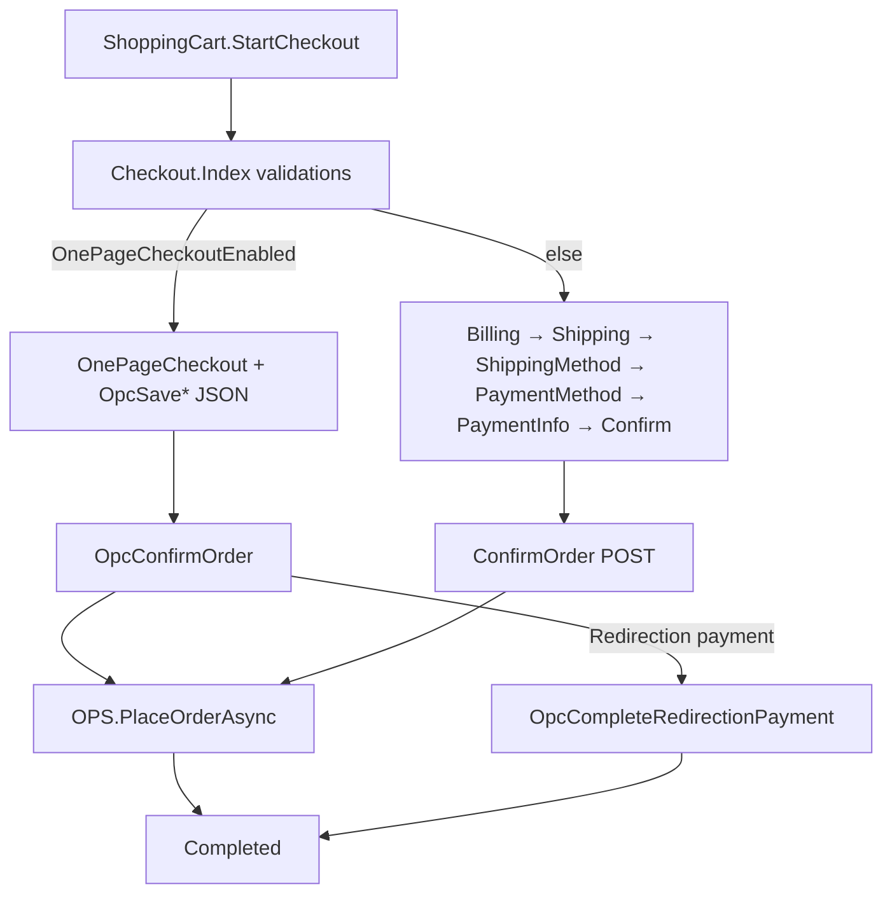
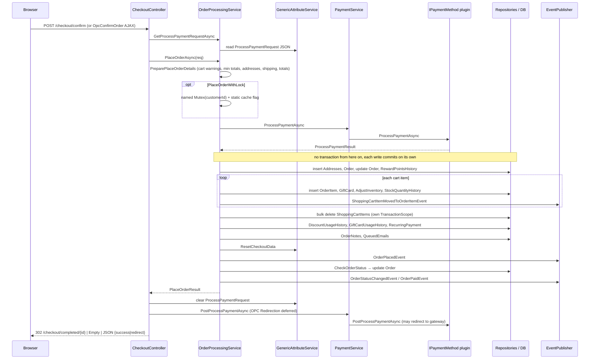

# Research: Checkout data flow and order processing

**Date**: 2026-10-18T13:28:47+02:00
**Researcher**: Claude (Opus 5.5) for pavel-agarkov
**Git Commit**: 13cdb1593b96ee4587ea21ef0efb209e74a07584
**Branch**: claude/10x-init-28240f
**Repository**: nopSolutions/nopCommerce

## Research Question

Analyze the storefront checkout process, paying special attention to the related areas defined in [context/map/repo-map.md](../../map/repo-map.md) (risk zone #1 "Orders / checkout": money loop with payments, shipping, tax, discounts). Three dimensions, investigated by parallel sub-agents:

1. **Trace e2e** — entry point → layers → write/read → back, with `file:line` and Mermaid.
2. **Test gaps** — which methods/branches on that path are covered and which are not.
3. **Blast radius** — what must change together: interface seams, registry/"generated" layers, model, migrations, tests; static graph + git co-change.

Scope: current state only. No recommendations.

Conventions in this document: paths are relative to `src/`. Abbreviations: **CC** = `Presentation/Nop.Web/Controllers/CheckoutController.cs` (2185 lines), **OPS** = `Libraries/Nop.Services/Orders/OrderProcessingService.cs` (3563 lines), **SCS** = `Libraries/Nop.Services/Orders/ShoppingCartService.cs` (2096 lines), **GA** = GenericAttribute. Each finding is tagged **[E]** evidence (read in code / tool output), **[I]** inference, **[U]** unknown.

## Summary

- **[E]** Checkout is a controller-driven, server-side flow with two front ends that share the same back end: a multi-step variant (full-page GET/POST + redirects) and a one-page checkout (OPC, AJAX + JSON). Both end in `OrderProcessingService.PlaceOrderAsync` (OPS:1594). `PlaceOrderAsync` has exactly 3 production call sites: CC:1332, CC:2072 and the PayPalCommerce plugin (`Plugins/Nop.Plugin.Payments.PayPalCommerce/Services/PayPalCommerceServiceManager.cs:2170`), so the plugin is a third entry point that bypasses `CheckoutController` (Appendix A, A3). Checkout state between steps lives in **GenericAttribute rows per customer and store**, not the HTTP session; the `ProcessPaymentRequest` itself is JSON-serialized into a GA (OPS:3321-3368).
- **[E]** `PlaceOrderAsync` runs, on this inspected path: validation/preparation (outside the inner `try`, OPS:1602) → payment through the plugin (**before** any DB write) → ~10 kinds of independent repository writes → events → status transitions. **No transaction wraps it**: across `src/`, `new TransactionScope(...)` occurs once (Data/DataProviders/BaseDataProvider.cs:533, inside `CreateTransactionScope`, :503), `BeginTransaction[Async]` occurs 0 times, and `CreateTransactionScope()` has 5 call sites — 3 bulk repository operations (Data/EntityRepository.cs:364, :470, :504) and 2 synchronous bulk helpers (Libraries/Nop.Services/Helpers/SyncCodeHelper.cs:103 `InsertEntities`, :119 `DeleteEntities`). None is on the `PlaceOrderAsync` path except the cart bulk delete (A1).
- **[E]** Test coverage of the placement path is **absent**: no test calls `PlaceOrderAsync`, any `CheckoutController`/`ShoppingCartController` action, or `GetShoppingCartWarningsAsync` directly (ast-grep 0, grep 0). Cart warnings and `IsPaymentWorkflowRequiredAsync` are, however, **executed indirectly** by model-factory tests that assert only model shape (A13). Covered: order-total math, `Can*` state guards, recurring-cycle dates, model-factory happy paths. No browser/E2E/`WebApplicationFactory` tests exist in `src/`.
- **[E]** Blast radius is wide and partly invisible to the static graph: each core interface has 1 implementation and is referenced by 7–49 other files (excluding its own definition file); 10 in-repo plugins (16 plugin files) reference `IShoppingCartService`; `IPaymentMethod` has 21 members, none with a default implementation, and its implementers derive only from `BasePlugin` (an `IPlugin` base); 9 consumers (6 plugins + 3 core) react to order/cart events at runtime; the OPC JS ↔ controller JSON contract and OPC URLs are untyped strings.
- **[E]** History confirms the repo map's friction signal for this area: `#7709` (OPC address prefill) landed twice on 2025-05-23 and was reverted on 2025-06-12 (`48e78a7b08`), touching CC, OPC views and `public.onepagecheckout.js`.

## 1. Feature overview

### 1.1 Entry and routing

1. **[E]** Cart page → `ShoppingCartController.StartCheckout` (Presentation/Nop.Web/Controllers/ShoppingCartController.cs:1376-1414): saves checkout attributes to a GA, runs `GetShoppingCartWarningsAsync`, then redirects to the checkout route, `Challenge()`, or login-as-guest depending on `AnonymousCheckoutAllowed` and downloadable products.
2. **[E]** `CC.Index` (CC:342-412): checks `CheckoutDisabled`, empty cart, guest + anonymous checkout not allowed → `Challenge()` (CC:359), "button-only" payment methods; calls `ResetCheckoutDataAsync` (CC:380); re-runs cart (CC:385) and item (CC:393) warnings; routes to `CHECKOUT_ONE_PAGE` when `OnePageCheckoutEnabled` (CC:408), else `CHECKOUT_BILLING_ADDRESS`. Named routes: Presentation/Nop.Web/Infrastructure/RouteProvider.cs:282-322.
3. **[E]** Checkout actions repeat the same guard block (CheckoutDisabled, empty cart, OPC flag, guest) — e.g. CC:1255-1269 and CC:2037-2050. Exact counts in CC (29 public `IActionResult` actions): `if (_orderSettings.CheckoutDisabled)` ×22, `if (!cart.Any())` ×22, `if (await _customerService.IsGuestAsync(customer) && !_orderSettings.AnonymousCheckoutAllowed)` ×21, `if (_orderSettings.OnePageCheckoutEnabled)` ×13 and `if (!_orderSettings.OnePageCheckoutEnabled)` ×8. **20 actions** carry both the CheckoutDisabled and empty-cart guards: Index, BillingAddress, NewBillingAddress, ShippingAddress, NewShippingAddress, ShippingMethod, SelectShippingMethod, PaymentMethod, SelectPaymentMethod, PaymentInfo, EnterPaymentInfo, Confirm, ConfirmOrder, OnePageCheckout, the 5 `OpcSave*` actions and OpcConfirmOrder; `SelectBillingAddress` (CC:647) and `SelectShippingAddress` (CC:804) carry the CheckoutDisabled guard with a different cart check (A6).

### 1.2 Multi-step variant

| Step | GET / POST | Writes (GA unless noted) |
|---|---|---|
| Billing address | `BillingAddress`, `SelectBillingAddress`, `NewBillingAddress` (CC:604, 644, 681) | customer billing address |
| Shipping address | `ShippingAddress`, `SelectShippingAddress`, `NewShippingAddress` (CC:772, 801, 828) | customer shipping address |
| Shipping method | `ShippingMethod` (CC:914), `SelectShippingMethod` (CC:968-1050) | `SelectedShippingOptionAttribute`, `DesiredDeliveryDate`, pickup point |
| Payment method | `PaymentMethod` (CC:1052), `SelectPaymentMethod` (CC:1107-1154) | `UseRewardPointsDuringCheckoutAttribute`, `SelectedPaymentMethodAttribute` |
| Payment info | `PaymentInfo` (CC:1156), `EnterPaymentInfo` (CC:1205-1250) | plugin `ValidatePaymentFormAsync` + `GetPaymentInfoAsync(form)` → `SetProcessPaymentRequestAsync` (CC:1242); empty request stored when plugin `SkipPaymentInfo` (CC:1193) |
| Confirm | `Confirm` GET (CC:1252) → `CheckoutModelFactory.PrepareConfirmOrderModelAsync` (Presentation/Nop.Web/Factories/CheckoutModelFactory.cs:602; warns only on min order total, :613) | — |
| Place order | `ConfirmOrder` POST (CC:1276-1363), `[ValidateCaptcha]` | see 1.4 |

`ConfirmOrder` **[E]**: guest captcha (CC:1300) → `IsMinimumOrderPlacementIntervalValidAsync` (CC:134-150, reads the customer's last order) → `GetProcessPaymentRequestAsync`; if null and payment required → redirect to PaymentInfo (CC:1317-1325) → sets StoreId, CustomerId, PaymentMethodSystemName, re-persists request (CC:1331) → `PlaceOrderAsync` (CC:1332).

### 1.3 One-page checkout (OPC)

- **[E]** `OnePageCheckout` (CC:1495) serves the page; AJAX steps `OpcSaveBilling` (CC:1519), `OpcSaveShipping` (:1673), `OpcSaveShippingMethod` (:1792), `OpcSavePaymentMethod` (:1880), `OpcSavePaymentInfo` (:1953). Chaining helpers `OpcLoadStepAfter*` (CC:1369-1493) auto-skip a step when only one shipping/payment method exists.
- **[E]** `OpcConfirmOrder` (CC:2017-2127) repeats the `ConfirmOrder` flow but throws instead of redirecting. After `PlaceOrderAsync` (CC:2072): Redirection-type payment → JSON `{redirect: ".../checkout/OpcCompleteRedirectionPayment"}` (CC:2088-2097); otherwise `PostProcessPaymentAsync` (CC:2100) and `{success:1}`. The JS (Presentation/Nop.Web/wwwroot/js/public.onepagecheckout.js:803-808) navigates to the success URL, `CHECKOUT_COMPLETED` (Views/Checkout/OnePageCheckout.cshtml:206).
- **[E]** `OpcCompleteRedirectionPayment` (CC:2129-2183) loads the customer's **latest** order in the current store and requires it to be at most 3 minutes old (CC:2156), then `PostProcessPaymentAsync`; returns `Empty` if the plugin redirected (CC:2168-2171).
- **[E]** OPC AJAX actions have **no named routes**; the view calls hard-coded URLs such as `'@(storeLocation)checkout/OpcSaveShipping/'` (Views/Checkout/OnePageCheckout.cshtml). JSON keys `update_section {name, html}`, `goto_section`, `redirect`, `wrong_billing_address` and section names `billing`, `shipping`, `payment-info`, `confirm-order` form the JS ↔ controller contract.

### 1.4 `PlaceOrderAsync` (OPS:1594-1721)

1. **[E]** Guard `OrderGuid != Guid.Empty` (OPS:1598).
2. **[E]** `PreparePlaceOrderDetailsAsync` (OPS:288-315), called **outside** the inner `try` (OPS:1602), builds `PlaceOrderContainer`:
   - `PrepareAndValidateCustomerAsync` (OPS:564): guest check again (OPS:572), currency, language.
   - `PrepareAndValidateShoppingCartAndCheckoutAttributesAsync` (OPS:489): reads `CheckoutAttributes` GA, loads cart, `GetShoppingCartWarningsAsync` (OPS:502 → SCS:1187), per-item `GetShoppingCartItemWarningsAsync` (OPS:511 → SCS:1141), `ValidateMinOrderSubtotalAmountAsync` / `ValidateMinOrderTotalAmountAsync` (OPS:519, :526 → OPS:3192, :3217).
   - `PrepareAndValidateBillingAddressAsync` (OPS:540), `PrepareAndValidateShippingInfoAsync` (OPS:426, reads `SelectedPickupPointAttribute` / `SelectedShippingOptionAttribute`).
   - `PrepareAndValidateTotalsAsync` (OPS:345): subtotal, shipping, tax, total, applied gift cards, redeemed reward points via `OrderTotalCalculationService`; sets `processPaymentRequest.OrderTotal` (OPS:416).
   - Affiliate, tax display type, `PrepareAndValidateRecurringShoppingAsync` (OPS:324).
3. **[E]** If `OrderSettings.PlaceOrderWithLock` is true: a **named OS `Mutex`** keyed by customer id plus a static-cache flag with TTL `MinimumOrderPlacementInterval` (OPS:1681-1718). Inside, async calls are blocked with `.Result` / `.Wait()`; the code comment states mutexes cannot be used with `await`.
4. **[E]** Local function `placeOrder` (OPS:1604-1679), in a `try` that converts any exception into `result.AddError(exc.Message)` (OPS:1663-1666):
   1. `GetProcessPaymentResultAsync` (OPS:1395-1430): load plugin, check active (OPS:1405, :1409), call `PaymentService.ProcessPaymentAsync` (Libraries/Nop.Services/Payments/PaymentService.cs:51-68 → `IPaymentMethod.ProcessPaymentAsync`) or `ProcessRecurringPaymentAsync`; no payment required → result Paid.
   2. On payment success, `SaveOrderDetailsAsync` (OPS:723-817): insert billing/pickup/shipping `Address` (OPS:775-788), clear `DesiredDeliveryDate` GA, `InsertOrderAsync` (OPS:800), `UpdateOrderAsync` for CustomOrderNumber (OPS:804), reward-points redemption entry + another update (OPS:810-814).
   3. `MoveShoppingCartItemsToOrderItemsAsync` (OPS:1283-1347), per item: `InsertOrderItemAsync` (OPS:1334), `AddGiftCardsAsync` (OPS:1337, :1359), `ProductService.AdjustInventoryAsync` (OPS:1340 → Libraries/Nop.Services/Catalog/ProductService.cs:1785, stock history at :1811/:1842), publish `ShoppingCartItemMovedToOrderItemEvent` (OPS:1343); then `ClearShoppingCartAsync` (OPS:1346 → SCS:659-670, bulk delete).
   4. `SaveDiscountUsageHistoryAsync` (OPS:1461), `SaveGiftCardUsageHistoryAsync` (OPS:1438), `CreateFirstRecurringPaymentAsync` (OPS:1233, recurring carts only).
   5. `SendNotificationsAndSaveNotesAsync` (OPS:824-859): OrderNote "Order placed", queued e-mails to store owner, customer (optional PDF), vendors, affiliate, each followed by a note.
   6. `ResetCheckoutDataAsync` (OPS:1637 → SCS:1935-1970), `SetShoppingCartVendorAsync(null)`, activity log `PublicStore.PlaceOrder` (OPS:1641), **publish `OrderPlacedEvent`** (OPS:1646).
   7. `CheckOrderStatusAsync` (OPS:1649) → `CheckAndSaveOrderStatusAsync` (OPS:1487) → `SetOrderStatusAsync` (OPS:1012): update Order, publish `OrderStatusChangedEvent` (OPS:1025), notes and e-mails, award reward points on Complete (OPS:1088), activate gift cards.
   8. If Paid → `ProcessOrderPaidAsync` (OPS:1107): publish `OrderPaidEvent` (OPS:1112), paid e-mails/notes, customer roles (OPS:1153).
   9. On failure, errors are aggregated and logged (OPS:1672-1676); `PlaceOrderResult.Errors` returned.

### 1.5 Return path

- **[E]** Multi-step success: `SetProcessPaymentRequestAsync(null)` (CC:1335) → `PaymentService.PostProcessPaymentAsync` (PaymentService.cs:75-87; skips the plugin when the order is already Paid) → `Empty` if the plugin redirected/posted, else redirect to `CHECKOUT_COMPLETED` with orderId (CC:1343-1349). Failure: Confirm view re-rendered with warnings (CC:1352-1362).
- **[E]** `Completed` (CC:414-444): guest check; order by id **or the customer's latest order** (CC:427-433); ownership and deleted checks; `DisableOrderCompletedPage` → OrderDetails; else `PrepareCheckoutCompletedModelAsync` (CheckoutModelFactory.cs:630-642).

### 1.6 Diagrams

### 1.7 State and persistence

- **[E]** Checkout state keys (GA, per customer + store): `SelectedShippingOptionAttribute`, `OfferedShippingOptionsAttribute`, `SelectedPickupPointAttribute`, `DesiredDeliveryDate`, `SelectedPaymentMethodAttribute`, `UseRewardPointsDuringCheckoutAttribute`, `CheckoutAttributes`, coupon codes. Across CC + OPS + SCS there are **51** `_genericAttributeService.SaveAttributeAsync[<T>](...)` calls over 12 distinct keys; the most written are `SelectedShippingOptionAttribute` (12 sites, 11 in CC), `SelectedPickupPointAttribute` (10) and `SelectedPaymentMethodAttribute` (9). Within these three files `OfferedShippingOptionsAttribute` is written only by `ResetCheckoutDataAsync` (SCS:1961). No `Session` usage in CC (ast-grep 0, grep 0) (A17). Write path: `GenericAttributeService.SaveAttributeAsync` (Libraries/Nop.Services/Common/GenericAttributeService.cs:124) — insert, update, or delete on empty value.
- **[E]** `ProcessPaymentRequest` (StoreId, CustomerId, OrderGuid, OrderTotal, PaymentMethodSystemName, recurring fields, `CustomValues`) is serialized with `JsonConvert` into GA `ProcessPaymentRequestAttribute` (OPS:3321-3368); OrderGuid is reused for `PaymentSettings.RegenerateOrderGuidInterval` (OPS:3348-3364). The order keeps the plugin `CustomValues` as `Order.CustomValuesXml` (Libraries/Nop.Core/Domain/Orders/Order.cs:237-239).
- **[E]** Tables written on a successful placement (via `IRepository<T>`/`EntityRepository`): Address, Order (1 insert + 2 updates in `SaveOrderDetailsAsync`, more in status handling), OrderItem, GiftCard, Product/combination stock + StockQuantityHistory, DiscountUsageHistory (Libraries/Nop.Services/Discounts/DiscountService.cs:690), GiftCardUsageHistory (Orders/GiftCardService.cs:289), RewardPointsHistory (Customers/RewardPointService.cs:202), RecurringPayment, OrderNote (Orders/OrderService.cs:836), QueuedEmail, ActivityLog, Log, ShoppingCartItem (bulk delete via `_sciRepository.DeleteAsync(cart, publishEvent: false)`, SCS:666 → EntityRepository.cs:470 with its own `TransactionScope`), GenericAttribute. Inside `SaveOrderDetailsAsync` the order writes are exactly: 3 conditional `InsertAddressAsync` (OPS:775, :780, :786), 1 `InsertOrderAsync` (OPS:800) and 2 `UpdateOrderAsync` (OPS:804, :814); further Order updates happen later in `SetOrderStatusAsync`. Single-entity `EntityRepository.InsertAsync` (Data/EntityRepository.cs:340-349) calls the data provider directly and then publishes `EntityInsertedEvent`.

### 1.8 Events and runtime consumers

- **[E]** Published on this path: `ShoppingCartItemMovedToOrderItemEvent`, `ClearShoppingCartEvent` (SCS:667), `ResetCheckoutDataEvent` (SCS:1970), `OrderPlacedEvent`, `OrderStatusChangedEvent`, `OrderPaidEvent`, plus generic `EntityInserted/Updated` per single-entity repository call. OPS contains 12 `PublishAsync(new …Event(...))` sites in total (OrderStatusChanged@1025, OrderPaid@1112, ShoppingCartItemMovedToOrderItem@1343, OrderPlaced@1646 and @2007 (recurring), OrderAuthorized@2462, OrderRefunded ×4, OrderVoided ×2). `OrderStatusChangedEvent` has exactly 2 publishers: OPS:1025 and Admin `Areas/Admin/Controllers/OrderController.cs:894` (A10).
- **[E]** The cart is cleared with `publishEvent: false` (SCS:666), so the per-item `EntityDeletedEvent<ShoppingCartItem>` consumers (GoogleAnalytics, Brevo, Omnisend, `CustomerEventConsumer`) **do not fire** on order placement; only `ClearShoppingCartEvent` is published, and it has 0 consumers. **[I]** Those consumers rely on the order events instead.
- **[E]** In-repo consumers (grep `IConsumer<...>`):

| Consumer | Events |
|---|---|
| Nop.Services `ReminderEventConsumer` (Reminders/ReminderEventConsumer.cs:15) | OrderStatusChanged |
| Nop.Services `CustomerEventConsumer` | ShoppingCartItem insert/update/delete |
| Nop.Web `ModelCacheEventConsumer` | Order and ShoppingCartItem entity events |
| Plugin Misc.Brevo | OrderPlaced, OrderPaid, cart events |
| Plugin Misc.Omnisend | OrderPlaced, Paid, Refunded, StatusChanged, cart events, `EntityInserted<OrderItem>` |
| Plugin Tax.Avalara | OrderPlaced, Refunded, StatusChanged, Voided, `EntityDeleted<Order>` |
| Plugin Widgets.GoogleAnalytics | OrderPlaced, Paid, Refunded, cart events |
| Plugin Widgets.FacebookPixel | OrderPlaced, cart item inserted |
| Plugin Misc.RFQ (Services/EventConsumer.cs:29) | ShoppingCartItemMovedToOrderItem, GetShoppingCartItemUnitPrice (pricing hook), cart events |

- **[E]** `ResetCheckoutDataEvent` and `ClearShoppingCartEvent` have no consumer in this repository (ast-grep 0, grep 0). `IConsumer<ModelPreparedEvent<BaseNopModel>>` is implemented by **6 plugins** — PayPalCommerce, Avalara, RFQ, FacebookPixel, Misc.News, Misc.Forums — and 1 core class (`AclEventConsumer`); the first four inspect checkout/cart models, News/Forums are unrelated to checkout (A11).

## 2. Test gaps

### 2.1 Test harness

- **[E]** One test project `Tests/Nop.Tests/Nop.Tests.csproj` (NUnit 4.6.1, Moq 4.20.72, AwesomeAssertions, Microsoft.Data.Sqlite; csproj lines 15-21). CI runs `dotnet test` on `src` (`.github/workflows/dotnet.yml:28`).
- **[E]** Tests use **real services on a real database**: `BaseNopTest.cs:110-129` installs with sample data; default provider is in-memory SQLite (`NopTestConfiguration.cs:26`, selected at `BaseNopTest.cs:603`); real `OrderProcessingService`, `OrderTotalCalculationService`, `ShoppingCartService`, `PaymentService`, `PaymentPluginManager` registered (BaseNopTest.cs:374, 375, 378, 381, 422). Moq only stubs web host pieces (BaseNopTest.cs:181-259).
- **[E]** Payment plugin in tests: `Nop.Services.Tests/Payments/TestPaymentMethod.cs` ("Payments.TestMethod"); `ProcessPaymentAsync` always returns Paid (lines 103-111).

### 2.2 Coverage table (static; see blind spots)

| Production method | Test anchor | Status |
|---|---|---|
| `OPS.PlaceOrderAsync` (OPS:1594) and helpers OPS:288-1487 | — | **Not covered** |
| `OPS.Can{Capture,Refund,PartiallyRefund,Void}[Offline]Async`, `CanCancel`, `CanMarkAsPaid/Authorized` | OrderProcessingServiceTests.cs:52-494 (status × payment × shipping combinations) | Covered (guards only; `CaptureAsync`/`RefundAsync`/`VoidAsync` not called) |
| `OPS.GetNextPaymentDateAsync`, `GetCyclesRemainingAsync` (OPS:3261, 3301) | OrderProcessingServiceTests.cs:496-697 | Covered |
| `OPS.SetProcessPaymentRequestAsync` / GUID (OPS:3336) | OrderProcessingServiceTests.cs:39-47 | Partial |
| `OPS.ProcessNextRecurringPaymentAsync` (1891), `ReOrderAsync` (3121), `ValidateMinOrder{Subtotal,Total}AmountAsync` (3192, 3217), `UpdateOrderTotalsAsync` (1728) | — | **Not covered** |
| `OPS.IsPaymentWorkflowRequiredAsync` (3241) | no direct call; executed via `CheckoutModelFactory.PreparePaymentMethodModelAsync` (CheckoutModelFactory.cs:523) in CheckoutModelFactoryTests.cs:153, 167, 175 | Executed, not asserted |
| `OTCS.GetShoppingCartSubTotalAsync`, shipping totals / free shipping, `GetTaxTotalAsync` | OrderTotalCalculationServiceTests.cs:176-553 | Covered |
| `OTCS.GetShoppingCartTotalAsync` (OTCS:1327) | OrderTotalCalculationServiceTests.cs:561, 583, 664 | Partial — gift card (OTCS:1393) and reward points (OTCS:1409) branches never asserted; `useRewardPoints=true` never passed |
| `OTCS.CalculateRewardPointsAsync` (1500) | — | Not covered |
| `SCS.GetShoppingCartWarningsAsync` (1187), `GetShoppingCartItemWarningsAsync` (1141), `GetStandardWarningsAsync` (337), `GetRequiredProductWarningsAsync` (230), `GetQuantityProductWarningsAsync` (559) | No direct call (ast-grep 0, grep 0). Executed indirectly: `GetShoppingCartWarningsAsync` runs unconditionally in `PrepareShoppingCartModelAsync` (ShoppingCartModelFactory.cs:983), which ShoppingCartModelFactoryTests.cs:93 and :103 call; `GetShoppingCartItemWarningsAsync` runs inside `AddToCartAsync` (SCS:1636, :1653) during setup (CheckoutModelFactoryTests.cs:72-74, return values discarded) | **Executed, not asserted** (no test checks a warning) |
| `SCS.GetUnitPriceAsync`, `GetSubTotalAsync` | OrderTotalCalculationServiceTests.cs:608-660 | Covered |
| `PaymentService.ProcessPaymentAsync` (51), `ProcessRecurringPaymentAsync` (292) | PaymentServiceTests.cs:19-33 only loads plugins | Not covered |
| `GiftCardService.IsGiftCardValidAsync`, remaining amount | GiftCardServiceTests.cs:35-82 | Covered |
| Checkout attribute parser/formatter | CheckoutAttributeParserAndFormatterTests.cs:112-185 | Covered (XML only) |
| `CheckoutModelFactory` Prepare* | Nop.Web.Tests/Public/Factories/CheckoutModelFactoryTests.cs:105-248 | Partial (happy paths, reward-points display 161-180) |
| `ShoppingCartModelFactory` Prepare* | ShoppingCartModelFactoryTests.cs:78-182 | Partial (mostly "not null") |
| All `CheckoutController` actions incl. `OpcSave*`, `OpcConfirmOrder` (CC:342-2129) | — | **Not covered** |
| `ShoppingCartController` `AddProductToCart_*`, `UpdateCart`, `StartCheckout`, `ApplyDiscountCoupon`, `ApplyGiftCard` | — | **Not covered** |

### 2.3 Untested branches on the money path [E]

- `PlaceOrderAsync`: empty-GUID throw (OPS:1598); payment failure → `Checkout.PaymentError` (OPS:1614/1656); recurring (OPS:1630); paid (OPS:1651); exception catch (OPS:1663); `PlaceOrderWithLock` branch (OPS:1681-1705).
- Anonymous checkout disabled: OPS:572, :621; CC:359, :418, :620.
- Pre-placement cart validation: empty cart, cart/item warnings (OPS:502, :511), min subtotal/total (OPS:519, :526).
- Totals not computable (OPS:370, :401); EU VAT branch (OPS:391).
- Plugin not loaded / inactive (OPS:1405, :1409); recurring payment type NotSupported/Manual/Automatic (OPS:1414-1419).
- Inventory adjustment (OPS:1340) and stock return (OPS:259); gift card usage history (OPS:1438-1445); reward points redeem/award/reduce/return (OPS:807-812, 866, 910, 943); gift card activation (OPS:968); discount usage history (OPS:1461-1472).
- Cart-level warnings: max cart items, mixing standard and recurring products (SCS:1217), vendor required (SCS:1221), required checkout attributes and text limits (SCS:1260-1323).

### 2.4 Browser / integration tests

- **[E]** Case-insensitive grep for `playwright|selenium|WebApplicationFactory|TestServer|cypress` over `*.cs, *.csproj, *.json, *.ts, *.js` matched only `.claude/skills/10x-e2e*` documentation; `find` for `*playwright*`, `*e2e*`, `*.spec.ts` found nothing in `src/`.
- **[E]** History since 2022-01-01: 27 non-merge commits touched checkout-related tests vs 126 touching the production files above; 16 touched both. Recent test commits follow production refactors (#8169, #8149, #7379/#7469); the only new-test content found is "Added CanGenerateOrderGuid test" (2024-11-29).

## 3. Blast radius

### 3.1 Interface seams [E]

| Seam | Impl. | Consumer files | Plugin consumers |
|---|---|---|---|
"Files" = files containing the identifier, excluding the interface's own definition file (ast-grep `kind: identifier`; equals `grep -rlw` minus 1). Breakdown: Libraries / Presentation / Plugins / Tests.

| Seam | Impl. | Files referencing | Breakdown | Plugin consumers |
|---|---|---|---|---|
| `IOrderProcessingService` | 1 (OPS:40) | 16 | 2 / 11 / 1 / 2 | PayPalCommerce |
| `IShoppingCartService` | 1 (SCS:32) | 49 | 9 / 19 / 16 / 5 | 10 plugins: RFQ, GoogleAnalytics, Omnisend, FacebookPixel, Avalara, FixedByWeightByTotal, PayPalCommerce, CheckMoneyOrder, PunchOut, Brevo |
| `IOrderTotalCalculationService` | 1 | 18 | 2 / 4 / 9 / 3 | 9 plugins: GoogleAnalytics, FacebookPixel, Tax.FixedOrByCountryStateZip, Omnisend, Avalara, UPS, Brevo, CheckMoneyOrder, PayPalCommerce |
| `IPaymentService` | 1 | 18 | 5 / 8 / 3 / 2 | Avalara, Tax.FixedOrByCountryStateZip, PayPalCommerce |
| `ICheckoutModelFactory` | 1 | 7 | 0 / 4 / 1 / 2 | PayPalCommerce (`PayPalCommerceModelFactory` calls `PreparePaymentInfoModelAsync`, `PrepareConfirmOrderModelAsync`) |
| `IPaymentMethod` | CheckMoneyOrder, PayPalCommerce, TestPaymentMethod | 14 | 2 / 7 / 3 / 2 | the 2 payment plugins |
| `IShippingRateComputationMethod` | UPS, FixedByWeightByTotal, FixedRateTestShippingRateComputationMethod (tests) | — | — | — |

Note: `IShoppingCartModelFactory` is two unrelated interfaces with the same name (public `Nop.Web/Factories/ShoppingCartModelFactory.cs:42`, admin `Areas/Admin/Factories/ShoppingCartModelFactory.cs:23`).

- **[E]** `IPaymentMethod` (Libraries/Nop.Services/Payments/IPaymentMethod.cs:10, `: IPlugin`) has 21 members (14 methods, 7 get-only properties) and none has a default implementation. All 3 implementers derive from `BasePlugin` (Libraries/Nop.Services/Plugins/BasePlugin.cs:6, `: IPlugin`), which supplies no payment behaviour — so there is no payment-specific base class. CheckMoneyOrder stubs Capture/Refund/Void/Recurring as "not supported"; PayPalCommerce implements them.
- **[E]** PayPalCommerce calls **12** distinct `IOrderProcessingService` methods (25 call sites, all in `PayPalCommerceServiceManager.cs`): `GetProcessPaymentRequestAsync` ×5, `SetProcessPaymentRequestAsync` ×3, `PlaceOrderAsync` ×1 (:2170), `CanMarkOrderAsAuthorized` ×2, `MarkAsAuthorizedAsync` ×2, `CanMarkOrderAsPaid` ×3, `MarkOrderAsPaidAsync` ×3, `CheckOrderStatusAsync` ×2, `CanVoidOffline`, `VoidOfflineAsync`, `CanPartiallyRefundOffline`, `PartiallyRefundOfflineAsync` — the most tightly coupled plugin. (Earlier draft said 13; corrected, A8.)
- **[I]** A change to `ProcessPaymentRequest` / `IPaymentMethod` reaches 17 non-test files (payment interfaces and service, OPS + interface, CC, `OrderController`, both payment plugins + `PayPalCommerceServiceManager`, `Order.cs`, `NopCustomerDefaults`, `SampleOrder.cs`, `Pdf/AddressItem.cs`, `UpgradeTo480/AddIndexesMigration.cs`) — built from direct references only.

### 3.2 Model and migrations [E]

Historical examples of an Order field change:

- **#7386 desired delivery date** (`d987710eed`, 2026-01-14, + test fix `beca8e8e34`): 34 files — `Order.cs`, `ShippingSettings`, `NopCustomerDefaults`; `UpgradeTo500/SchemaMigration.cs` (`AddOrAlterColumnFor<Order>(t => t.DesiredDeliveryDateUtc)`); `SettingMigration`, `LocalizationMigration`, `defaultResources.nopres.xml`, `InstallRequiredData`; OPS, `CustomerService`; CC, checkout/cart/order factories, 4 public models, 5 public views, DefaultClean CSS; admin `OrderModel`, `OrderModelFactory`, `_OrderDetails.BillingShipping.cshtml`, shipping settings model/factory/controller/view, `AdminMapperConfiguration`; `ExportManagerTests.cs` (holds a list of Order property names).
- **#7743 Reminders** (`8865456e89`): `Order.LastPendingOrderFollowUp*` → `Order.cs`, `SchemaMigration`, `AddIndexesMigration`, `Installation/Indexes.cs`, `MessageTokenProvider`, `WorkflowMessageService`, `RemindersMigration`, `SettingMigration`, `LocalizationMigration`, `nopres.xml`.
- **#8169 / #8170** (`a01d7bb5ee`, `9de1519380`): moved credit-card fields out of Order into Payments.Manual, then removed that plugin from core — touched `Order.cs`, `ProcessPaymentRequest/Result`, payment service, OPS, `ExportManager`/`ImportManager`, `SampleOrder`, `BaseDataProvider`, admin order controller/factory/model/view, localization, a plugin `OrderMigration.cs`.
- **[E]** `OrderBuilder.cs` maps only FKs, string lengths and the unique column. **[I]** A new nullable scalar column needs no builder change.

Observed lockstep for a new Order field: entity + `UpgradeTo<next>/SchemaMigration` + `ExportManagerTests` (seen in all of #7386/#7743/#8169 that added columns **[I: from 3 examples]**); conditionally admin model/factory/view/`AdminMapperConfiguration`, `OrderBuilder` (FK/string), `ExportManager`/`ImportManager`, `MessageTokenProvider`, PDF items, `nopres.xml` + `LocalizationMigration`.

### 3.3 Registry layers [E]

- **DI**: Presentation/Nop.Web.Framework/Infrastructure/NopStartup.cs (order/payment/shipping services, scoped, ~lines 198–263); Presentation/Nop.Web/Infrastructure/NopStartup.cs (public checkout/cart factories). Plugins register their own services; event consumers are discovered at runtime.
- **Routes**: RouteProvider.cs:282-322 (named checkout routes); OPC AJAX endpoints hard-coded in the view (§1.3).
- **Settings**: `OrderSettings` changes co-change with `OrderSettingsModel` (6), `AdminMapperConfiguration` (6), OPS (6), `SettingModelFactory` (5), `SettingController` (5), `InstallRequiredData` (5), `nopres.xml` (7), and require `UpgradeTo*/SettingMigration`. `ShoppingCartSettings` follows the same pattern plus `ShoppingCartController`/`ShoppingCartModelFactory`.
- **Localization**: each new string goes to `nopres.xml` (fresh install) and `UpgradeTo<ver>/LocalizationMigration.cs` (upgrade).

### 3.4 Co-change since 2022-01-01 [E]

Method: `git log --since=2022-01-01 --no-merges --name-only`, excluding commits touching >200 files (17 commits), bot/dependabot/github-actions/Claude authors, lockfiles and minified files. Anchor commits (kept / all non-merge): CC 32/34, OPS 39/46, CheckoutModelFactory 10/16.

| CheckoutController (32) | # | OrderProcessingService (39) | # | CheckoutModelFactory (10) | # |
|---|---|---|---|---|---|
| public.onepagecheckout.js | 7 | defaultResources.nopres.xml | 12 | CheckoutController | 7 |
| Views/Checkout/OnePageCheckout.cshtml | 7 | MessageTokenProvider | 10 | nopres.xml | 4 |
| ShoppingCartModelFactory | 7 | CheckoutController | 7 | DefaultClean styles.css | 3 |
| CheckoutModelFactory | 7 | AdminMapperConfiguration | 7 | AdminMapperConfiguration | 3 |
| nopres.xml | 7 | Admin SettingController | 7 | Admin SettingModelFactory | 3 |
| PayPalCommerce/plugin.json | 7 | PayPalCommerceServiceManager | 7 | Admin SettingController | 3 |
| OrderProcessingService | 7 | IOrderProcessingService | 7 | UpgradeTo460/LocalizationMigration | 3 |
| Views/Checkout/OpcBillingAddress | 6 | InstallationService | 7 | public.onepagecheckout.js | 2 |
| Admin SettingController | 6 | InstallRequiredData | 7 | | |
| PayPalCommerceServiceManager | 6 | Admin SettingModelFactory | 6 | | |

`Order.cs` itself appears in 3 kept commits (#7386, #7743, #8169).

### 3.5 Reverts touching this area [E]

| Commit | Date | Subject | Files |
|---|---|---|---|
| `48e78a7b08` | 2025-06-12 | #7744 Revert "#7709 One-page checkout does not pre-fill address fields…" (after `d8848ff2a5`, `6ac5092420` on 2025-05-23) | CC, OnePageCheckout.cshtml, OpcBillingAddress.cshtml, public.onepagecheckout.js |
| `2d2955927e` | 2026-01-29 | Revert "#8083 Continue Shopping button redirects to incorrect page" (#8083 took 4 commits: `958f5b9809`, revert, `e5728da8f6`, `ea7a7be012`) | ShoppingCartController, CatalogController |
| `3f19686119` | 2026-09-03 | Revert "#8239 Inconsistency in currency parsing" (original `4cd15f70c6`, 2026-06-29) | not file-listed in this research |
| `db6c197d83` | 2023-08-10 | Revert "#6811 Renamed #region Utils" | cosmetic |

Repo-map claims checked: `#7709` "landed twice then reverted, 2025-06" — **supported**. `#8239` "reverted after 66 days" — **supported** (2026-06-29 → 2026-09-03); "no re-land found" — still **unknown** (no later `#8239` commit found by `git log --grep=#8239`; a re-land under a different message is not ruled out). `#8083` "landed, reverted and re-landed within a day, 4 commits" — **supported**.

## 4. Technical debt

Described as observed; no recommendations. Severity is not assigned here.

### 4.1 Consistency and failure handling

- **[E] No transaction around order placement.** OPS:1604-1679 performs ~10 kinds of writes, each committing independently (§1.7); the 5 `CreateTransactionScope()` call sites are bulk operations only (EntityRepository.cs:364, :470, :504; SyncCodeHelper.cs:103, :119), and of those only the cart delete (:470) is reached during placement.
- **[E] Payment before persistence.** `GetProcessPaymentResultAsync` runs at the top of `placeOrder` (OPS:1610), before `SaveOrderDetailsAsync`.
- **[I] Partial orders after a mid-flow failure.** An exception after `InsertOrderAsync` (e.g. in `MoveShoppingCartItemsToOrderItemsAsync` or notifications) is caught at OPS:1663, the result reports failure, yet the Order row (and possibly a captured payment) remains; ConfirmOrder would show errors for an order that exists. Follows from the code shape; not reproduced.
- **[E] Exceptions flattened to strings.** The pattern `catch (Exception exc) { … exc.Message … }` occurs **10 times in CC** (:304 `EditAddressAsync`, :331 `DeleteAddressAsync`, :1355 ConfirmOrder, :1665/:1784/:1872/:1944/:2010/:2122 the 5 `OpcSave*` actions and OpcConfirmOrder, :2178 OpcCompleteRedirectionPayment) and **7 times in OPS** (:1663 placement, :2068 and :2124 recurring, :2535 capture, :2689 and :2876 refunds, :3039 void). `PreparePlaceOrderDetailsAsync` is outside the inner try (OPS:1602), so validation failures surface as exceptions to the controller rather than `PlaceOrderResult` errors.
- **[E] Duplicate-order protection is process-local and sync-over-async.** The `PlaceOrderWithLock` branch uses a named OS `Mutex` (OPS:1691) and is the only sync-over-async code in OPS: `.Result` ×3 (OPS:1700, :1705, :1709 — the last blocks on the whole `placeOrder`) and `.Wait()` ×1 (OPS:1712). The same named-`Mutex` idiom appears 6 more times outside checkout (PictureService.cs:463, :567, :597; UploadedImagesMigration.cs:174; BaseNopTest.cs:746, :773). **[I]** A named mutex and the static cache are per machine/process, so they do not cover multi-instance deployments; blocking calls hold a thread-pool thread for the full placement.
- **[E] Heuristic order lookup.** CC has 3 "latest order of this customer" lookups (`SearchOrdersAsync(…, pageSize: 1)`): CC:142 (minimum placement interval), CC:430 (`Completed` fallback when no id is given) and CC:2143 (`OpcCompleteRedirectionPayment`, accepted if ≤ 3 minutes old, CC:2156).

### 4.2 Size and duplication

- **[E] God classes.** Constructor parameter counts (ast-grep, `parameter` inside `constructor_declaration`): CC **28** (CC:71, 2185 lines); OPS **50** (OPS:99, 3563 lines); public `ShoppingCartModelFactory` **50** (ShoppingCartModelFactory.cs:102 — the repo map's 48 is corrected); SCS **31** (SCS:72, 2096 lines); `CheckoutModelFactory` **31** (:67); `OrderTotalCalculationService` **22** (:55).
- **[E] OPC vs multi-step duplication.** `SelectShippingMethod` (CC:968-1050) and `OpcSaveShippingMethod` (CC:1792-1877) are near line-for-line copies differing in redirect vs JSON/throw; likewise `SelectPaymentMethod`/`OpcSavePaymentMethod`, `EnterPaymentInfo`/`OpcSavePaymentInfo`, `ConfirmOrder`/`OpcConfirmOrder` (CC:1310-1350 vs 2052-2103). The guard block is repeated in 20 actions (exact counts in §1.1).
- **[E] Repeated validation.** `GetShoppingCartWarningsAsync` has 7 production call sites: cart page model (ShoppingCartModelFactory.cs:983, :1093), `StartCheckout` (ShoppingCartController.cs:1389), `Index` (CC:385), `PlaceOrderAsync` (OPS:502), admin order edit `UpdateOrderTotalsAsync` (OPS:1742) and PayPalCommerce (PayPalCommerceServiceManager.cs:1431). On one multi-step checkout the cart rules are evaluated at least at StartCheckout → Index → PlaceOrder. `IsPaymentWorkflowRequiredAsync` has 10 call sites: 8 in CC (:1073, :1135, :1176, :1225, :1321, :1404, :1914, :2061), 1 in `CheckoutModelFactory` (:523), 1 in OPS (:1400). The guest check runs in 21 CC actions and again in OPS:572. `PostProcessPaymentAsync` is called from 4 controller sites: CC:1341, :2100, :2166 and `OrderController.cs:278` (re-post payment from order details).

### 4.3 Contracts and coupling

- **[E] Untyped JS ↔ controller contract.** OPC endpoints are 6 hard-coded URL strings in `Views/Checkout/OnePageCheckout.cshtml` (:66 OpcSaveBilling, :96 OpcSaveShipping, :133 OpcSaveShippingMethod, :162 OpcSavePaymentMethod, :185 OpcSavePaymentInfo, :206 OpcConfirmOrder) with no `Opc*` entry in RouteProvider.cs (grep; Razor has no ast-grep grammar). CC emits the keys in anonymous objects — `update_section` ×16, `goto_section` ×9, `redirect` ×5, `success` ×2, `wrong_billing_address` ×1 — and the JS reads them by member access (ast-grep JS: `update_section` @76-77, `goto_section` @96-97, `redirect` @100-101/803/805, `wrong_billing_address` @180-184, `success` @808). `public.onepagecheckout.js` and `OnePageCheckout.cshtml` co-change with CC in 7 of 32 commits; `#7709` was reverted across exactly these files.
- **[E] Payment request as a JSON blob in GenericAttribute**: one `JsonConvert.SerializeObject` (OPS:3367) and one `DeserializeObject<ProcessPaymentRequest>` (OPS:3327) in OPS; written at OPS:3343 and :3368, including plugin `CustomValues`; later copied to `Order.CustomValuesXml` (Order.cs:237-239).
- **[E] `IPaymentMethod`: 21 members, no default implementations, no payment base class.** **[U/I]** Any member change breaks every third-party payment plugin.
- **[E] PayPalCommerce reaches deep into core** (12 distinct OPS methods over 25 call sites, its own `PlaceOrderAsync` entry point at PayPalCommerceServiceManager.cs:2170, `ICheckoutModelFactory`) and co-changes with CC/OPS (6–7 commits each).
- **[E] Runtime coupling via events and model rewriting** (§1.8): 6 plugins + 3 core consumers on order/cart events; 4 checkout-relevant plugins (of 6 plugins total) handle `ModelPreparedEvent<BaseNopModel>`. Not visible in the static graph.
- **[E] Feature-add lockstep**: entity + `SchemaMigration` + `SettingMigration` + `LocalizationMigration` + `nopres.xml` + `InstallRequiredData` + `AdminMapperConfiguration` + admin settings hub (§3.2–3.3). `ExportManagerTests` hard-codes Order property names and broke on #7386.

### 4.4 Security-adjacent observations

- **[E]** `OpcSavePaymentInfo` carries `[IgnoreAntiforgeryToken]` (CC:1952) while the controller is `[AutoValidateAntiforgeryToken]` (CC:32). It is the only exemption in CC; storefront controllers have 5 in total — the other 4 are `ShoppingCartController.UploadFileProductAttribute` (:1087), `UploadFileCheckoutAttribute` (:1167), `ReturnRequestController.cs:312` and `ScheduleTaskController.cs:22`, i.e. file uploads and the task runner. `OpcSavePaymentInfo` is the only exempt action that handles a payment form. **[U]** The reason (e.g. payment iframe/plugin forms posting without a token) is not documented at that line.

### 4.5 Test debt

- **[E]** Zero direct test calls (ast-grep and grep both 0 in `src/Tests`) for `PlaceOrderAsync`, `GetShoppingCartWarningsAsync`, `GetShoppingCartItemWarningsAsync`, `ProcessPaymentAsync`, `ProcessRecurringPaymentAsync`, `AdjustInventoryAsync`, `ValidateMinOrderSubtotalAmountAsync`, `IsPaymentWorkflowRequiredAsync`, `CalculateRewardPointsAsync`, `ReOrderAsync`, `UpdateOrderTotalsAsync`; no test instantiates or names `CheckoutController` or `ShoppingCartController`. Cart warnings and the payment-workflow check are reached only indirectly, without assertions (§2.2). No E2E/browser/HTTP-pipeline tests. The test payment plugin always returns Paid, so the failure branch has no fixture.

## Code References

- `Presentation/Nop.Web/Controllers/CheckoutController.cs:32` — `[AutoValidateAntiforgeryToken]`; `:71-98` ctor; `:342-412` Index; `:1276-1363` ConfirmOrder; `:1952` `[IgnoreAntiforgeryToken]`; `:2017-2127` OpcConfirmOrder; `:2129-2183` OpcCompleteRedirectionPayment
- `Presentation/Nop.Web/Controllers/ShoppingCartController.cs:1376-1414` — StartCheckout
- `Presentation/Nop.Web/Factories/CheckoutModelFactory.cs:602`, `:630-642` — confirm / completed models
- `Presentation/Nop.Web/Infrastructure/RouteProvider.cs:282-322` — checkout routes
- `Presentation/Nop.Web/wwwroot/js/public.onepagecheckout.js:803-808` — OPC success navigation
- `Libraries/Nop.Services/Orders/OrderProcessingService.cs:288-315` prepare; `:1395-1430` payment; `:723-817` save order; `:1283-1347` cart → order items; `:1594-1721` PlaceOrderAsync; `:1681-1718` mutex; `:3321-3368` payment request in GA
- `Libraries/Nop.Services/Orders/ShoppingCartService.cs:1141`, `:1187` warnings; `:659-670` clear cart; `:1935-1970` reset checkout data
- `Libraries/Nop.Services/Payments/PaymentService.cs:51-68`, `:75-87`
- `Libraries/Nop.Data/DataProviders/BaseDataProvider.cs:503`; `Libraries/Nop.Data/EntityRepository.cs:340-349`, `:364`, `:470`, `:504`
- `Libraries/Nop.Core/Domain/Orders/Order.cs:237-239` — CustomValuesXml
- `Tests/Nop.Tests/BaseNopTest.cs:110-129`, `:374-422`; `Tests/Nop.Tests/Nop.Services.Tests/Payments/TestPaymentMethod.cs:103-111`

## Architecture Insights

- Layering is classic nopCommerce: thin-ish MVC controller → model factory (read) / domain service (write) → `IRepository<T>` over LinqToDB. Business invariants for placement live almost entirely in `OrderProcessingService`; the controller duplicates many pre-checks.
- Extensibility is by DI override (`virtual`/`partial` services and controllers), plugin interfaces (`IPaymentMethod`, `IShippingRateComputationMethod`), event consumers and `ModelPreparedEvent`. This is why the static graph understates coupling ([repo-map.md](../../map/repo-map.md) "Real couplings").
- State is persisted per step in the DB (GenericAttribute), making checkout survivable across requests/servers but scattering it over many keys.

## Historical Context (from prior changes)

Not applicable: `context/changes/` holds only this change and `context/archive/` is empty. The repo map ([repo-map.md](../../map/repo-map.md), risk zone #1) is the only prior artifact; its claims checked here are listed in §3.5 and below:

- "Tests are thin: about 9 test files by name" — **partially supported**: the relevant test files number ~11 (§2), but more importantly the placement path has zero direct tests.
- "50 injected dependencies in `OrderProcessingService`" — **confirmed**: ast-grep counts exactly 50 constructor parameters (OPS:99).
- "48 in `ShoppingCartModelFactory`" — **refuted**: the public `ShoppingCartModelFactory` constructor has 50 parameters (ShoppingCartModelFactory.cs:102).

## Related Research

None yet. Evidence for the repo map: `context/map/evidence/1-history.md`, `3-structure.md`.

## Open Questions (blind spots)

- **[U]** Real line/branch coverage: no coverage tool, build or test run was executed; whether tests pass at HEAD is unknown.
- **[U]** Default values of `PlaceOrderWithLock`, `MinimumOrderPlacementInterval`, `OnePageCheckoutEnabled` in installed data.
- **[U]** Runtime DI overrides, installed/active payment plugins in a real deployment. Neither in-repo payment plugin is `PaymentMethodType.Redirection`, so the OPC redirection branch has no in-repo exerciser.
- **[U]** Behaviour when an event consumer throws mid-placement (whether it aborts the remaining steps), and DB isolation per statement.
- **[U]** What third-party plugins put into `CustomValues`; external Web API / mobile clients' coupling to Order fields (WebApi.Frontend in repo has 4 `.cs` files and does not reference these services).
- **[U]** Rationale for `[IgnoreAntiforgeryToken]` on `OpcSavePaymentInfo`.
- **[U]** Whether `#8239` was re-landed under another commit message.
- **[U]** Consumers of generic `EntityInserted/Updated<Order|OrderItem>` events beyond `ModelCacheEventConsumer` and Avalara were not fully traced.
- **[I]** The partial-order failure mode (§4.1) is inferred from code shape and should be confirmed by a targeted test before being relied upon.
- **[U]** Razor views (`.cshtml`) have no ast-grep grammar; claims about them (OPC URLs) rest on grep only. ast-grep also cannot see DI-resolved or reflection-based calls (`EngineContext.Current.Resolve`, `IConsumer<>` discovery in NopStartup.cs:308), so every call-site count in Appendix A is a count of *syntactic* call sites.

## Appendix A — Structural claims verified with ast-grep

Tool: ast-grep 0.51.0 (`-l csharp`, and `-l js` for A15), run from `src/` at commit 13cdb1593b. Every result of 0 was re-checked with `grep -rn`/`grep -rlw`; where both are 0 the absence is treated as real. Verdicts: **confirmed** (claim holds as stated), **refined** (holds, but the count or scope was wrong or incomplete), **refuted** (does not hold).

| # | Claim (original wording, abbreviated) | ast-grep pattern / rule | Result (files:lines) | Verdict |
|---|---|---|---|---|
| A1 | "Only `TransactionScope` is `BaseDataProvider.CreateTransactionScope`, used only by bulk repository ops (EntityRepository:364, 470, 504)" | `new TransactionScope($$$)`; `$R.CreateTransactionScope()`; `$R.BeginTransaction($$$)`; `$R.BeginTransactionAsync($$$)` | 1 × `new TransactionScope` (BaseDataProvider.cs:533); 5 × `CreateTransactionScope()` — EntityRepository.cs:364, 470, 504 **and SyncCodeHelper.cs:103, 119**; `BeginTransaction*` 0 (grep: 0 in `src/Libraries`+`src/Presentation`) | **Refined** — 2 omitted call sites (sync bulk helpers); conclusion "no transaction around placement" unchanged |
| A2 | "Mutex branch uses `.Result`/`.Wait()`" | `$X.Result`, `$X.Wait()` in OPS; `new Mutex($$$)` repo-wide | `.Result` ×3 (OPS:1700, 1705, 1709), `.Wait()` ×1 (OPS:1712) — all inside the lock branch; `new Mutex` ×7, 1 in OPS:1691, 6 elsewhere (PictureService ×3, UploadedImagesMigration, BaseNopTest ×2) | **Confirmed** (and bounded: no other sync-over-async in OPS) |
| A3 | "Both variants end in `PlaceOrderAsync`" (implying controller-only entry) | `$S.PlaceOrderAsync($$$)` | 3 production calls: CC:1332, CC:2072, **PayPalCommerceServiceManager.cs:2170** (+ plugin-internal wrapper PayPalCommerceModelFactory.cs:282) | **Refined** — third entry point via PayPalCommerce |
| A4 | "Cart warnings run in StartCheckout, Index, and again in PlaceOrder" | `$S.GetShoppingCartWarningsAsync($$$)` | 7 production sites: ShoppingCartModelFactory.cs:983, 1093; ShoppingCartController.cs:1389; CC:385; OPS:502; OPS:1742; PayPalCommerceServiceManager.cs:1431 | **Refined** — the three named sites confirmed; 4 more exist (cart page model ×2, admin order edit, PayPal) |
| A5 | "`IsPaymentWorkflowRequiredAsync` evaluated several times (CC:1321, OPS:1400)" | `$S.IsPaymentWorkflowRequiredAsync($$$)` + receiver-less `IsPaymentWorkflowRequiredAsync($$$)` in OPS | 8 in CC (1073, 1135, 1176, 1225, 1321, 1404, 1914, 2061), 1 in CheckoutModelFactory.cs:523, 1 in OPS:1400 (found only by the receiver-less pattern; grep agrees) | **Confirmed**, quantified: 10 sites |
| A6 | "Guard block repeated across ~20 actions" | `if (_orderSettings.CheckoutDisabled) $BODY`; `if (!cart.Any()) $BODY`; guest-check pattern; YAML rule: public `method_declaration` that `has` both guards | CheckoutDisabled ×22 (grep 22), `!cart.Any()` ×22, guest check ×21, OPC flag ×13 / negated ×8; 20 of 29 public actions have both guards | **Confirmed**, quantified: exactly 20 (22 with the CheckoutDisabled guard alone) |
| A7 | "CC 28-param ctor; OPS 50 deps (repo map); `ShoppingCartModelFactory` 48 (repo map)" | YAML: `kind: parameter` inside `parameter_list` inside `constructor_declaration` | CC 28 (:71), OPS 50 (:99), **ShoppingCartModelFactory 50** (:102), SCS 31, CheckoutModelFactory 31, OTCS 22 | CC, OPS **confirmed**; ShoppingCartModelFactory 48 **refuted** (50) |
| A8 | "PayPalCommerce calls 13 distinct `IOrderProcessingService` methods" | `_orderProcessingService.$M($$$)` in the plugin, grouped by `$M` | 12 distinct methods, 25 calls, all in PayPalCommerceServiceManager.cs (grep `-ohE … \| sort -u`: 12) | **Refuted** — 12, not 13 |
| A9 | "Each core interface has 1 implementation; 17 / 50 / 19 / 19 / 8 / 15 consumer files" | YAML: `class_declaration` with `base_list` containing the interface identifier; `kind: identifier` regex per interface, distinct files | 1 implementation each (OPS:40, SCS:32, OTCS:24, PaymentService.cs:12, CheckoutModelFactory.cs:27); file counts 17/50/19/19/8/15 **include the interface's own file** (grep `-rlw` identical) | **Refined** — referencing files excluding the definition are 16/49/18/18/7/14 |
| A10 | "Published on this path …; Admin `OrderController.cs:894` also publishes `OrderStatusChangedEvent`" | `$E.PublishAsync(new $T($$$))` in OPS and SCS; `$E.PublishAsync(new OrderStatusChangedEvent($$$))` repo-wide | OPS 12 publish sites (listed in §1.8), SCS 2 (ClearShoppingCart@667, ResetCheckoutData@1970); OrderStatusChanged publishers exactly OPS:1025 and Admin OrderController.cs:894 | **Confirmed** |
| A11 | "Consumers: 6 plugins + 3 core on order/cart events; Reset/ClearShoppingCart have no consumers; 4 plugins use `ModelPreparedEvent`" | YAML: `generic_name` with identifier `IConsumer` inside `base_list`, filtered by event type | Order/cart consumers: GoogleAnalytics, FacebookPixel, Avalara, Omnisend, Brevo, RFQ + CustomerEventConsumer, ReminderEventConsumer, ModelCacheEventConsumer; Reset/Clear: 0 (grep 0); `ModelPreparedEvent<BaseNopModel>`: PayPalCommerce, Avalara, RFQ, FacebookPixel, **Misc.News, Misc.Forums** + core AclEventConsumer. 205 base-list entries vs 220 grep hits — the 15 extra grep hits are comments, the interface definition and reflection (EventPublisher.cs:23, NopStartup.cs:308, BaseNopTest.cs:448) | Order consumers **confirmed**; Reset/Clear zero **confirmed**; `ModelPreparedEvent` **refined** — 6 plugins (4 checkout-relevant) + 1 core |
| A12 | "No test calls `PlaceOrderAsync` / cart warnings / payment processing / controller actions" | `$S.<Method>($$$)` over `Tests/` for 11 methods; `new CheckoutController($$$)`, `new ShoppingCartController($$$)` | All 0; grep 0 for each (only the `TestPaymentMethod` declarations of `ProcessPaymentAsync`/`ProcessRecurringPaymentAsync`); controller names 0 in `Tests/` | **Confirmed** (true absence, not pattern failure) |
| A13 | "Cart warnings / `IsPaymentWorkflowRequiredAsync`: not covered" | YAML: `method_declaration` that `has` (stopBy: end) a call to either method, in both public factories; then grep factory calls in `Tests/` | Enclosing methods: `PrepareShoppingCartModelAsync` (:922, call at :983 unconditional), `PrepareShoppingCartItemModelAsync`, `PrepareWishlist*`, `PreparePaymentMethodModelAsync` (:504); tests call `PrepareShoppingCartModelAsync` (ShoppingCartModelFactoryTests.cs:93, 103) and `PreparePaymentMethodModelAsync` (CheckoutModelFactoryTests.cs:153, 167, 175); `await $S.AddToCartAsync($$$);` 3 hits with discarded results, `$V = await $S.AddToCartAsync($$$)` 0 | **Refined** — executed indirectly, never asserted |
| A14 | "Exceptions flattened to strings at OPS:1663, CC:1355, CC:2122" | YAML: `catch_clause` that `has` `$E.Message` | CC 10 sites, OPS 7 sites (lines in §4.1) | **Refined** — systemic pattern (17 sites), not 3 |
| A15 | "OPC JS ↔ controller contract is untyped strings / hard-coded URLs" | `kind: anonymous_object_creation_expression` containing `update_section`; JS: `$R.update_section` etc. | CC anonymous objects with `update_section` ×16 (grep `update_section\s*=` 16), `goto_section` ×9, `redirect` ×5, `success` ×2, `wrong_billing_address` ×1; JS reads at 76-77, 96-97, 100-101, 803-808, 180-184; URLs: 6 in OnePageCheckout.cshtml (grep only), 0 `Opc` in RouteProvider.cs | **Confirmed** |
| A16 | "`OpcSavePaymentInfo` is `[IgnoreAntiforgeryToken]` in an `[AutoValidateAntiforgeryToken]` controller" | YAML: `kind: attribute`, regex `^IgnoreAntiforgeryToken` | 5 in storefront controllers: CC:1952, ShoppingCartController.cs:1087, 1167, ReturnRequestController.cs:312, ScheduleTaskController.cs:22 (grep 5) | **Confirmed**, refined in scope — the only exempt action handling a payment form; the others are uploads/task runner |
| A17 | "Checkout state in GenericAttribute, not session; keys …" | `_genericAttributeService.SaveAttributeAsync($$$)` **plus** `…SaveAttributeAsync<$T>($$$)`; `$X.Session` | 51 writes / 12 keys across CC+OPS+SCS (grep 51); first pattern alone found only 22 (generic calls missed); `Session` 0 (grep 0) | **Confirmed**; counts added |
| A18 | "Order insert + 2–3 updates" | YAML: Insert/Update Order/Address calls `inside` `SaveOrderDetailsAsync`/`PlaceOrderAsync`/`MoveShoppingCartItemsToOrderItemsAsync` | `InsertAddressAsync` ×3 (775, 780, 786), `InsertOrderAsync` ×1 (800), `UpdateOrderAsync` ×2 (804, 814) | **Refined** — 1 insert + 2 updates in `SaveOrderDetailsAsync`; more updates later via `SetOrderStatusAsync` |
| A19 | "Latest-order heuristics (Completed, OpcCompleteRedirectionPayment)" | `$S.SearchOrdersAsync($$$, pageSize: 1)` in CC | 3 sites: CC:142, 430, 2143 | **Refined** — a third use (minimum placement interval) |
| A20 | "`IPaymentMethod` has 21 members and no base class" | YAML: `method_declaration`/`property_declaration` inside interface `IPaymentMethod`; implementer base lists (A9 rule) | 21 members (14 methods, 7 get-only properties), 0 with a body; implementers `: BasePlugin, IPaymentMethod` (BasePlugin implements only `IPlugin`) | **Confirmed** (wording made precise) |
| A21 | "Cart cleared by bulk delete with its own TransactionScope" | read SCS:659-670 after A1 | `_sciRepository.DeleteAsync(cart, publishEvent: false)` (SCS:666) → EntityRepository.cs:470 | **Confirmed**; new fact: `publishEvent: false` suppresses per-item delete events |

**Pattern pitfalls found during verification** (each would have produced a false "absence" or an undercount):
- Generic invocations (`SaveAttributeAsync<T>(…)`) are not matched by `SaveAttributeAsync($$$)`; both forms are needed (A17: 22 vs 51).
- Calls without a receiver (`IsPaymentWorkflowRequiredAsync(…)` inside OPS) are not matched by `$S.Method($$$)` (A5).
- Anonymous-object keys must be matched structurally (`anonymous_object_creation_expression`), not as `$X.key`, on the C# side.
