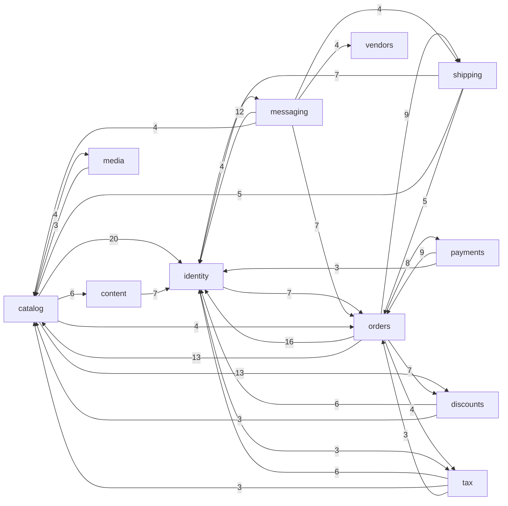

# Evidence: structure

Source: static dependency graph at HEAD 5b31db5b27, tracked files only, per capability (`capabilities.tsv` via `attribute.mjs`). Labels: **[E]** evidence (a command produced the number), **[I]** inference, **[U]** unknown. "Files" = distinct source `.cs` files, tests (`src/Tests`, 158 files) excluded.

## Graph sources

| Language / artefact | Source | Level | Confidence | Blind spots |
| --- | --- | --- | --- | --- |
| MSBuild projects (41 `.csproj`) | `<ProjectReference>` parsed from XML (no build, no restore; `$(SolutionDir)` resolved to `src`) -> `.work/edges-csproj.csv`, 45 edges | 2 (toolchain, equivalent to `dotnet list reference`) | high for assembly layering | `PackageReference` not in graph; project-level only |
| C# (3503 non-test `.cs`, 664 namespaces, 13333 `using` lines, 9847 `Nop.*`) | `using Nop.*` extracted with node regex, resolved to the file(s) declaring the namespace (longest declared prefix; one canonical target file per namespace x capability) -> `.work/edges-cs.csv`, 8825 file edges | **4 (universal fallback), confidence: low-medium** | namespace-level, not type-level | see below |
| Razor (986 `.cshtml`), JS/TS (25 first-party `.js/.ts`, 265 vendored `lib`/`lib_npm` ignored), gulp build | **no graph** | - | - | views reach models/services via `@model`/`@inject` (790 `@using/@model Nop.` lines seen, not folded); JS is gulp tooling and `wwwroot/js` scripts |

Level 1 check **[E]**: no dependency rules, architecture tests or boundary tooling in the repo (no `.editorconfig` IDE0005 / analyzer rule enforcing unused-using removal either, so `using` edges can overstate coupling). Level 3 check **[E]**: no dotnet-deptree/NDepend on PATH. I did not run `dotnet build/restore`.

C# resolution caveats of the fallback **[E/I]**:
- 17 "hub" namespaces are declared by files of 3+ capabilities (`Nop.Web.Areas.Admin.Controllers` 15 caps, `...Admin.Factories` 13, `...Models.Settings` 11, `Nop.Web.Components` 10, `Nop.Web.Factories` 9, `Nop.Web.Controllers` 9 ...). A `using` of those cannot say which capability is used, so those 6456 edges were set aside in `.work/edges-cs-hubns.csv` and are NOT in the capability graph. Presentation-layer coupling (controller/factory <-> factory) is therefore under-counted.
- Attribution of Presentation files is by file-name keyword (scan-contract weakness): `OrderModelFactory` counts as `orders`, so "orders -> catalog" from web files can be a factory touching products, not domain coupling.
- `using` is compile-time and can be unused; no type-only vs runtime split is possible (false-signal 9 not separable). All edges treated as `runtime`.
- Unattributed volume: 0 of the graph's files fell outside `capabilities.tsv` (graph-metrics `Unmapped: 0`); catch-all buckets `ops` (381 .cs), `foundations` (279), `platform` (221) are large by design, so edges to/from them are weak signals.

## Capability graph

Project-level layering (**[E]**, csproj, acyclic, 0 cycles):
`Nop.Core <- Nop.Data <- Nop.Services <- Nop.Web.Framework <- Nop.Web`. Nop.Core Ca 4/Ce 0; Nop.Data Ca 3/Ce 1; Nop.Services Ca 2/Ce 2; Nop.Web.Framework Ca 17/Ce 3 (16 plugins + Nop.Web); Nop.Web Ca 19/Ce 4 (**18 of 34 plugins reference Nop.Web directly**, the other 16 reference Framework only; no plugin references Nop.Services or another plugin in csproj). `Nop.Tests` references only `Nop.Web`.

Capability-level binary metrics (`graph-metrics.mjs ... --modules capabilities.tsv --kind runtime`; 20 nodes, 244 edges out of 380 possible; **one 19-node cycle = the whole graph is one strongly connected blob**, only `integrations` is outside it):

| Capability | Ca | Ce | Instability | Files importing it from other caps (weighted, Ca-files) | Own files importing other caps |
| --- | --: | --: | --: | --: | --: |
| foundations | 19 | 16 | 0.46 | 1284 | 80 |
| ops | 19 | 17 | 0.47 | 600 | 232 |
| identity | 19 | 12 | 0.39 | 529 | 157 |
| localization | 19 | 4 | **0.17** | 525 | 62 |
| catalog | 18 | 15 | 0.45 | 302 | 179 |
| platform | 18 | 16 | 0.47 | 246 | 188 |
| orders | 14 | 14 | 0.50 | 164 | 122 |
| messaging | 16 | 15 | 0.48 | 141 | 150 |
| content | 15 | 11 | 0.42 | 115 | 220 |
| payments | 8 | 13 | 0.62 | 110 | 47 |
| media | 13 | 8 | 0.38 | 95 | 30 |
| shipping | 11 | 8 | 0.42 | 81 | 74 |
| discounts | 9 | 7 | 0.44 | 73 | 42 |
| tax | 12 | 13 | 0.52 | 64 | 73 |
| search | 5 | 9 | 0.64 | 23 | 35 |
| admin-ui / frontend-ui / vendors / ai | 7/6/10/6 | 17/16/9/9 | 0.71/0.73/0.47/0.60 | - | - |
| integrations | 0 | 15 | 1.00 | 0 | 95 |

Binary Ca/Ce saturate (almost everything touches almost everything), so the weighted columns are the readable signal **[I]**.

Domain-layer subgraph (`Nop.Core` + `Nop.Services` files only, utility sinks foundations/localization/ops/platform/UI/integrations removed, edges with >= 3 importing files, label = importing files; `.work/cap-graph-domain.mmd`; 35 edges). Level-4 data, DI/plugin discovery invisible:

(4 further edges of weight 3-4 omitted from the picture: messaging->content, messaging->payments, catalog->messaging, identity->catalog; all in the file `.work/cap-graph-domain.mmd`.)

Highest fan-in namespaces, i.e. the load-bearing contracts **[E]** (`.work/cs-ns-fanin.tsv`; importing files / importing capabilities): `Nop.Web.Framework.Models` 899/19, `Nop.Core` 423/20, `Nop.Services.Localization` 406/20, `Nop.Web.Framework.Mvc.ModelBinding` 370/18, `Nop.Core.Domain.Catalog` 334/19, `Nop.Core.Domain.Customers` 310/20, `Nop.Core.Domain.Orders` 205/15, `Nop.Data` 179/19, `Nop.Core.Domain.Common` 170/18, `Nop.Services.Helpers` 165/20, `Nop.Services.Security` 160/18, `Nop.Services.Customers` 155/18, `Nop.Services.Messages` 136/19, `Nop.Services.Catalog` 120/18, `Nop.Services.Orders` 83/16, `Nop.Core.Domain.Shipping` 101/11, `Nop.Core.Domain.Tax` 67/13.

## Blast radius per capability

Counts = distinct non-test files in *other* capabilities that import the capability's namespaces (in) and distinct own files that import other capabilities (out). Top partners shown. **[E]** unless marked.

| High-criticality capability | In: foreign files / caps | Top importers (files) | Out: own files / caps | Top dependencies (files) |
| --- | --: | --- | --: | --- |
| identity (accounts, ACL, auth) | **529** / 19 | content 67, catalog 58, messaging 53, orders 47, platform 47, ops 42, tax 26, admin-ui 26, integrations 23 | 157 / 15 | foundations 128, ops 48, localization 39 |
| catalog | 302 / 18 | ops 59, platform 57, orders 34, messaging 18, integrations 18, admin-ui 16, content 12, discounts 11, search 11 | 179 / 17 | foundations 141, localization 69, identity 58, ops 44 |
| orders | 164 / 16 | platform 28, ops 27, messaging 17, **payments 16**, catalog 14, identity 14, shipping 8, tax 8 | 122 / 15 | foundations 90, ops 48, identity 47, catalog 34, payments 22, shipping 21, tax 13 |
| payments | 110 / 18 | **orders 22**, messaging 16, admin-ui 13, integrations 8, tax 7 | 47 / 13 | foundations 31, orders 16, localization 14 |
| shipping | 81 / 10 | orders 21, ops 15, platform 13, admin-ui 9, catalog 6 | 74 / 10 | foundations 51, ops 28, identity 18, orders 8 |
| tax | 64 / 12 | orders 13, identity 9, foundations 7, ops 7, admin-ui 7, messaging 6 | 73 / 12 | foundations 58, identity 26, ops 24, catalog 8, orders 8, payments 7 |
| ops (config, plugins, logging, ExportImport, caching ...) | **600** / 19 | content 75, messaging 61, identity 48, orders 48, admin-ui 47, catalog 44, platform 43, foundations 41, integrations 31 | 232 / 16 | foundations 95, catalog 59, localization 42, identity 42, orders 27 |
| platform (Nop.Data, Migrations, Nop.Web remainder) | 246 / 18 | foundations 39, content 37, messaging 20, integrations 20, ops 19 | 188 / 16 | catalog 57, identity 47, ops 43, orders 28 |
| foundations (Nop.Core, Web.Framework) | **1284** / 19 | content 169, catalog 141, messaging 129, identity 128, ops 95, orders 90, admin-ui 76, integrations 68 | 80 / 16 | ops 41, platform 39, identity 31 |

Medium capabilities for reference: localization In 525 (a near-pure sink, Ce 0.17), media 95, messaging 141, content 115, discounts 73, search 23 (integrations: In 0, 95 own files out).

**[I]** Reading: a change to `identity`, `ops`, `localization` or `foundations` reaches >= 500 foreign files; `catalog` ~300; `orders` is mid-sized (164) but is the money path and is entangled with 4 other money/stock capabilities (payments, shipping, tax, discounts). Payments, shipping, tax are small as *targets* (64-110 files) but consume `orders`/`identity`. Plugin-delivered capabilities (payments PayPal/CheckMoneyOrder, tax Avalara/Fixed, shipping UPS/Fixed/Pickup) are leaf entries: **[E]** no file outside `src/Plugins` has a `using Nop.Plugin.*` (`git grep` = 0 files), so core never references a plugin statically; plugin discovery is at runtime (see Unknowns).

## Cycles

Runtime, namespace-level in `src/Libraries` (`.work/edges-ns-libraries.csv`; 162 namespaces, 977 edges) **[E]**:
- One 33-node SCC across `Nop.Services.*` and one 17-node SCC across `Nop.Core.*` (domain entities cross-reference: Catalog, Common, Customers, Directory, Localization, Security, Seo ...). Both are hairballs; the *smallest real loops* are the 23 mutual namespace pairs below. These are `using`-level and may include unused usings (not enforced).
- Smallest named loops (files that create each direction):
  - `Nop.Services.Orders` <-> `Nop.Services.Payments`: `Payments/ProcessPaymentRequest.cs` imports Orders; `Orders/IOrderProcessingService.cs`, `OrderProcessingService.cs`, `OrderTotalCalculationService.cs` import Payments (1 vs 3 files).
  - `Orders` <-> `Catalog`: `Catalog/ProductReviewService.cs` imports Orders; 7 files in Orders import Catalog.
  - `Orders` <-> `Customers`: 5 Customers files import Orders (`CustomerRegistrationService`, `CustomerReportService`, `ICustomerReportService`, `CustomerCacheEventConsumer`...); 5 Orders files import Customers.
  - Others (weights = importing files each way): Catalog<->Messages 3/2, Customers<->Messages 2/5, Catalog<->Discounts 3/1, Catalog<->Media 3/1, Common<->Orders 1/4, Discounts<->Orders 1/2, Messages<->Orders 2/1, Common<->Shipping 1/2, Authentication<->Customers 1/1, Customers<->Security 1/2, Plugins<->Themes 1/1, Common<->Plugins 1/1, ExportImport<->Localization 2/1, Localization<->Plugins 2/1, Logging<->ScheduleTasks 1/2.
  - `Nop.Data.Extensions` <-> `Nop.Data.Mapping` (2-node cycle inside the data layer).
- Capability level: the 19-node SCC of the capability graph is the same hairball folded; do not read it as a single loop **[I]**.
- Cross-assembly cycles: none (csproj graph acyclic **[E]**; compiler would forbid them).

## Broken boundaries

Intended layering **[I]**: Core (entities, no logic) <- Data (mappings, migrations) <- Services (domain logic per folder) <- Web.Framework (MVC infrastructure) <- Web / plugins (controllers, factories, views). Layer-to-layer file edges (`.work/cs-agg-edges-cs.txt`): web>services 1154, services>core 1065, web>core 885, web>framework 794, plugin>services 766, services>services 571, plugin>core 520, plugin>framework 475, framework>core 294, framework>services 179, services>data 81, plugin>data 139. Upward edges (core->services, data->services, services->framework/web, framework->web): **0** (as expected, compiler-enforced). So violations are mostly *horizontal* or *skip-layer*:

| # | Finding | Evidence |
| --- | --- | --- |
| 1 | **Plugins reach into the Nop.Web presentation project** (not just Framework): 18/34 plugins reference `Nop.Web.csproj`; 64 plugin files import `Nop.Web.*` (non-Framework): Admin.Factories 11, Nop.Web.Infrastructure 9, Admin mapper extensions 9, Models.Catalog 6, Controllers 5, Models.Customer 4, Admin.Models.Orders 4 | [E] csproj + `git grep`; [I] plugins are coupled to the host's view-model layer, so renaming a Web model/factory can break plugins that nothing in core imports |
| 2 | **Plugins write to the data layer directly**: 139 plugin files import `Nop.Data` (`Nop.Data` 41, `.Extensions` 35, `.Migrations` 34, `.Mapping.Builders` 19) | [E]; expected for plugin-owned tables, but couples every plugin to migration infra |
| 3 | **Services layer imports `Nop.Data`** (81 files) | [E]; repository access in services is the project's design, not a violation |
| 4 | **Domain capability tangles** in `Nop.Services`: Orders <-> Payments, Orders <-> Catalog, Orders <-> Customers, Catalog <-> Messages (see Cycles); `Nop.Services.Common`/`Installation`/`ExportImport` (bucket `ops`) import Catalog 56, Orders 27, Discounts 19, Shipping 15, Vendors 11, Content 12 files at library level (ExportImport > Catalog domain 5, Orders 4; Installation > Shipping/Catalog/Vendors) | [E]; `ops` is a grab-bag that behaves as an "upper" layer over the domains **[I]** |
| 5 | **Framework knows domains**: foundations -> identity 31 files, localization 25, content 13, catalog 10, tax 7, vendors 7, orders 7 (`Nop.Web.Framework` filters/models importing Customers, Orders, Catalog namespaces) | [E]; **[I]** shared MVC infrastructure that imports concrete domain services is a load-bearing but non-neutral layer |
| 6 | **Platform knows domains**: platform (Nop.Data, Nop.Web remainder, Migrations) -> catalog 57, identity 47, ops 43, orders 28, localization 26 | [E]; expected (mappings/migrations reference entities) |
| 7 | **Core domain namespaces are mutually cyclic** (17-node SCC inside `Nop.Core`): entity types reference each other across Catalog/Customers/Common/Directory/Localization/Security | [E]; **[I]** the `Nop.Core.Domain` model is one big graph, so splitting a capability out requires moving entities together |

Not a violation by itself **[I]**: UI-to-domain edges (`admin-ui`, `frontend-ui`, factories) pointing down.

## Test risks

Only one test project (`Nop.Tests`, 158 `.cs` files, references Nop.Web) **[E]**. Tests attributed by keyword: ops 35, foundations 31, catalog 21, identity 12, messaging 10, shipping 9, orders 9, content 9, localization 7, tax 4, ai 4, vendors 2, payments 2, discounts 2, media 1 (158 files, `git ls-files src/Tests/*.cs | attribute.mjs`).

Heavy-mocking / integration-only zones **[E/I]** (files with >= 10 injected readonly fields: 134; `.work/ctor.mjs`):
- `orders`: `OrderProcessingService` 50 injected deps; `ShoppingCartModelFactory` 48, `Admin OrderModelFactory` 44, web `OrderModelFactory` 36, `ShoppingCartController` 35, `CheckoutModelFactory` 31 (19 files >= 10). Pulls payments/shipping/tax/discounts/catalog/identity. Isolation needs a large mock surface; realistic testing is integration against `Nop.Data` or e2e.
- `catalog`: `ProductService` 38, Admin `ProductController` 50, Admin/web `ProductModelFactory` 45/44, `CatalogModelFactory` 32 (22 files).
- `ops`: `ImportManager` 44, `ExportManager` 42, `PdfService` 31 - cross-domain; hard in isolation.
- `messaging`: `MessageTokenProvider` 37 (13 files); `identity`: `CustomerController` 44, `CustomerModelFactory` 39 (9 files).
- `payments`: `PayPalCommerceServiceManager` 34 (plugin, external API); also plugin services RFQ `RfqService` 28, Omnisend `OmnisendEventsService` 26, ChatGPT feed 22, Forums `ForumService` 21 - external-service clients: mock the client or use contract tests.
- Global state / service locator **[E]**: `EngineContext.Current.Resolve` appears 135 times in 58 files (top: `ApplicationBuilderExtensions` 25, `PluginService` 10, `MigrationExtensions` 9, `BaseController` 9), 304 DI registration lines (`AddScoped/Transient/Singleton`) in 26 files, `INopStartup` in 37 files. Code resolving via the static engine cannot be unit-tested without bootstrapping the engine.
- Capabilities with few/no tests by keyword attribution: payments 2, discounts 2, vendors 2, media 1, search/frontend-ui 0 **[E]**, though keyword attribution may hide tests for them under other names **[U]**.

## Centres and thin entry points

- **Load-bearing contracts** (high Ca, low instability) **[I]**: `Nop.Core` (Ca 20 caps, Ce 0 at project level), `Nop.Core.Domain.Catalog` (334 importing files), `Nop.Core.Domain.Customers` (310), `Nop.Services.Localization` (406 files / 20 caps, localization instability 0.17), `Nop.Services.Security` (160), `Nop.Services.Customers` (155), `Nop.Services.Helpers` (165), `Nop.Services.Messages` (136).
- **Config-as-code fan-in (false-signal 2)**: `Nop.Web.Framework.Models` (899 files) and `Nop.Web.Framework.Mvc.ModelBinding` (370) are base-model/binder types every view model inherits - cheap-ish coupling by design, changes surface at compile time. `Nop.Data` (179), `Nop.Data.Extensions` (134) and `Nop.Core.Configuration` (116) are likewise infrastructure imports; `Nop.Web.Areas.Admin.Infrastructure.Mapper.Extensions` (102) is a mapper helper. Count once as shared infrastructure, not as risk of any one capability.
- **Thin entry points / leaves**: `integrations` has In 0 (all 193 .cs files are plugins loaded at runtime; they are entry candidates, not core). Individual plugin csproj files all have Ca 0 (34 entry candidates) and each pulls Framework or Web.
- **Mutual money loop (`orders` <-> `payments` <-> `shipping`/`tax`/`discounts`)** is the most coupled business cluster outside of `identity`/`catalog` **[I]**: orders -> payments 8 files, payments -> orders 9, orders -> shipping 9, orders -> discounts 7, orders -> tax 4, shipping -> orders 5, tax -> orders 3.

## Mechanical signals

- 6456 file edges to the 17 multi-capability "hub" namespaces (Admin.Controllers/Factories/Models.Settings, Web.Components/Factories/Controllers ...) set aside as ambiguous (`.work/edges-cs-hubns.csv`) - not scored.
- `Nop.Web.Framework.Models` fan-in 899 and ModelBinding 370 (base types; false-signal 2). Localization fan-in (406 files, 20 caps) is a shared dependency used by every UI/message path, not per-capability risk.
- `using` edges cannot be split into type-only vs runtime: 32 alias and 5 `using static` among 13333 statements (negligible); unused usings not excluded.
- Tests excluded (158 files), 2 `.Designer.cs/.g.cs/AssemblyInfo` generated files excluded; no `global using` files exist (`git grep "^global using"` = 0), so file-scoped imports are complete for C#.
- Build edges: `src/Build/src/ClearPluginAssemblies` csproj has 0 references to the main graph (build tool, ignored).
- Build/type-only cycles: none detectable (project graph acyclic; type-only edges not separable).
- Delete-history: removed plugins (Sendinblue, AmazonPay, CyberSource, PayPalStandard, Manual, EasyPost, ShipStation, NivoSlider, AccessiBe, What3words) are not in HEAD graph (false-signal 11); Forums/News/Polls moved from core to plugins in the window, so older core coupling to them no longer exists.

## Unknowns

- **[U] Runtime coupling is invisible to this graph.** nopCommerce wires behaviour via DI and a plugin system: 304 DI registration lines in 26 files, `INopStartup` in 37 files, `EngineContext.Current.Resolve` 135x in 58 files, reflection/type-finder (`Activator.CreateInstance`, `GetTypes`, `ITypeFinder`) 38 lines in 18 files, plugin extension interfaces (`IPaymentMethod` 13 files, `ITaxProvider` 10, `IShippingRateComputationMethod` 9, `IWidgetPlugin` 30, `IExternalAuthenticationMethod` 12, `IMultiFactorAuthenticationMethod` 12), 210 `IConsumer<>` event-consumer lines in 41 files (130 `Entity*` handlers; 11 in content/Forums-News-Polls, 5 in messaging, 3 in integrations): event consumers couple capabilities by entity changes (for example a Forums or Omnisend consumer reacting to Customer/Order events) with no `using` of the producer service. Static coupling therefore **under-reports** payments/shipping/tax/search/messaging plugin links and the real impact of core changes on plugins.
- **[U]** Which plugin implements `IPaymentMethod` etc. is only decided at runtime from the installed set; core-to-plugin contracts (interfaces in `Nop.Services.Payments/Shipping/Tax`) are visible, the implementers' behaviour under a core change is not.
- **[U] External consumers**: nopCommerce is shipped as source/NuGet-less platform; third-party plugins and themes outside this repo (marketplace) consume `Nop.Services`, `Nop.Core.Domain`, `Nop.Web.Framework`; WebApi.Frontend and NopMobileApp plugins expose HTTP contracts consumed by clients outside the repo. Blast radius to those consumers is unknown (false-signal 10).
- **[U]** Razor views (986 `.cshtml`), view components and JS (25 first-party files) have no graph; view-to-model/service coupling (`@inject`, `@model`) is not in the numbers.
- **[U]** Hub-namespace (Admin/Web controllers/factories) coupling is not resolved to capabilities (type-level resolution needs Roslyn); web-layer fan-in/out is under-counted; keyword attribution of Presentation files makes `orders`/`catalog`/`identity` web numbers partly name-driven.
- **[U]** Unused `using` directives overstate edges; no analyzer in repo enforces IDE0005, so each edge is "imports", not proven "calls".
- **[U]** Tooling worth installing (not installed, level 3): `dotnet-deptree` or NDepend (type-level, reflection-aware assembly graph), or a Roslyn-based script to resolve type usage per capability and split hub namespaces; a CI architecture test (NetArchTest/ArchUnitNET) would make the intended layering explicit.
- **[U]** Tests-by-capability is a keyword guess; test coverage and execution (which tests hit which service) not measured.

## Commands run (all read-only, no installs)

- `git ls-files '*.csproj' '*.cs' '*.cshtml' '*.js' '*.ts'` counts; `git grep` counts for DI/reflection/consumer/plugin-interface patterns and for `global using`
- `node context/map/.work/proj.mjs` -> `edges-csproj.csv` (ProjectReference XML parse), `csproj-packages.tsv`
- `node context/map/.work/cs-edges.mjs` -> `edges-cs.csv`, `edges-cs-hubns.csv`, `cs-namespace-caps.tsv`, `cs-ns-fanin.tsv`, `cs-unresolved-nop-usings.txt` (0 unresolved)
- `node context/map/.work/cs-agg.mjs edges-cs` -> `cs-agg-edges-cs.txt`; `cs-blast.mjs <cap...>`; `cs-mermaid.mjs` -> `cap-graph-domain.mmd`; `ns-edges.mjs` -> `edges-ns-libraries*.csv`; `ctor.mjs`
- `node .claude/skills/10x-repo-map/scripts/graph-metrics.mjs context/map/.work/edges-cs.csv --modules context/map/.work/capabilities.tsv --kind runtime --unmapped group` (+ `--format json` -> `cap-metrics-cs.json`); the same script on `edges-csproj.csv` and `edges-ns-libraries.csv`
