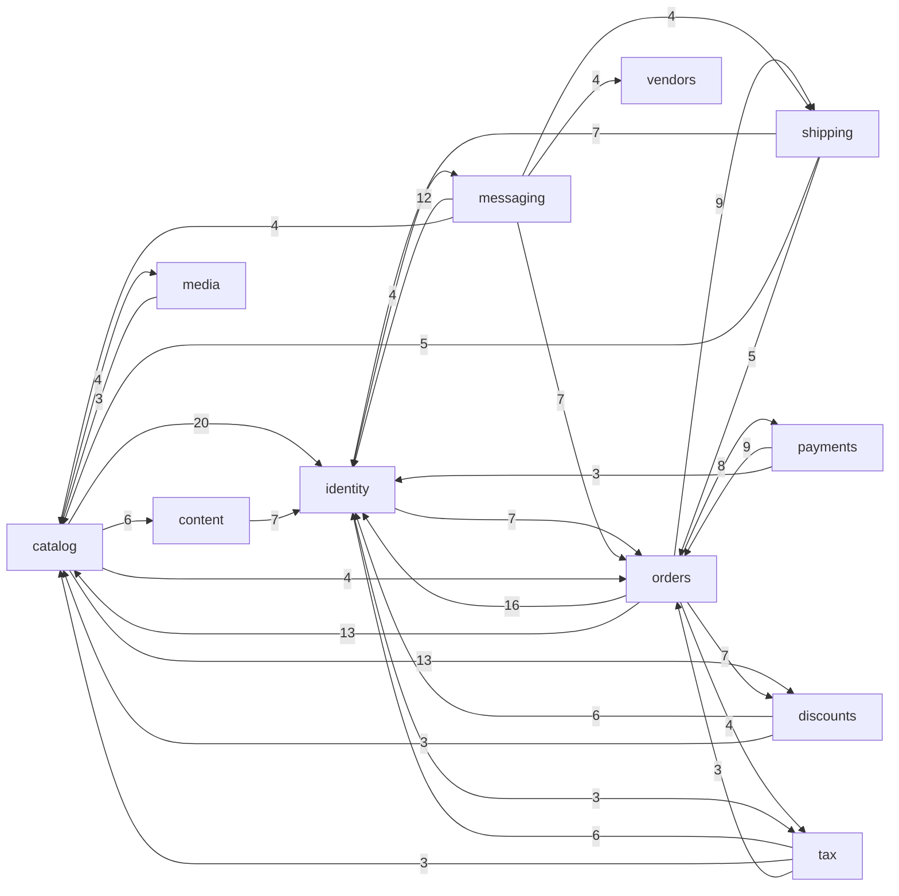

# nopCommerce Project Map

## TL;DR

nopCommerce is an open-source, multi-store e-commerce platform in C#/.NET, shipped as source with an admin area, a storefront, a plugin system (34 plugins: payments, shipping, tax, messaging, integrations) and a core team of four people who write 82% of the commits. Its value sits in **catalog** (products, pricing) and **orders** (cart, checkout, order processing), backed by **identity**, **payments/shipping/tax** and **admin operations** (settings, import/export, installation). The graph below shows the domain-layer dependencies between capabilities; the catch-all layers are left out.

The activity is flat and seasonal (peaks Q4/Q1 with each release) and is dominated by shared layers (Framework, Core, Data, migrations). Among real business capabilities the buzz concentrates in **catalog** (most changes, highest fix share, 52 bug issues) and **orders/checkout** (most reverts and second attempts, the most entangled money path). Two capabilities qualify as risk zones; identity, payments, ops and a few others are on a watch list. Static coupling understates the real picture: DI, the plugin system and event consumers wire most behaviour at runtime.

*Source: `evidence/3-structure.md` (edge label = importing files; Nop.Core + Nop.Services only; edges of weight 3+). DI and plugin discovery are invisible here.*

## Terrain

Buzz families: **change** (commits, trend), **fix** (fix share, reverts), **friction** (reverts, second attempts, heavy threads), **reach** (files in other capabilities that import it). Values are relative: H / M / L. Commits are the counted set; a commit counts once for each capability it touches, so the columns overlap.

| Capability | What it does | Crit. (criteria) | Change | Fix | Friction | Reach | Trend | Lives in |
|---|---|---|---|---|---|---|---|---|
| catalog | products, categories, pricing, reviews, attributes | **H** (core value, user data, others depend) | H (322 commits, rank 3) | H (24%, 38% without cross-cutting) | M (3 reverts, 52 bug issues) | H (302 files) | constant, 2025 spike | `Nop.Services/Catalog`, Admin + Web `Product*`/`Catalog*` |
| orders | cart, checkout, orders, returns, gift cards | **H** (money, core value, user data) | M (250) | H (23%, 35%) | H (4 of 14 reverts, `#7709`, `#8083`) | H (164 files; 50-dependency service) | constant | `Nop.Services/Orders`, `Checkout`/`ShoppingCart` controllers |
| identity | accounts, roles/ACL, auth, MFA, GDPR | **H** (access, user data, public) | M (238, rank 8 without sweeping) | L (12%) | M (captcha `#6690`) | **H (529 files, highest of any business capability)** | constant | `Nop.Services/Customers`, `Security`, `Authentication` |
| payments | payment methods, PayPal Commerce | **H** (money, external) | M (88; spike 2024-25, fading) | M (17%, small n) | L (0 reverts) | M (110) | fading | plugins `Payments.*`, `Nop.Services/Payments` |
| shipping | rates, UPS, pickup | **H** (money, external) | L (64) | L (11%) | M (UPS OAuth thread, 29 comments) | M (81) | settling | plugins `Shipping.*`, `Pickup.*` |
| tax | Avalara, fixed rates | **H** (money, legal) | L (72) | L (13%) | L | L (64) | constant | plugins `Tax.*`, `Nop.Services/Tax` |
| ops | settings, schedule tasks, plugins, logging, import/export, installation | **H** (can break runtime, admin) | H (423) but partly mechanical | L (typos, tests; demoted) | L | H (600 files) | constant | `Nop.Services/{Common,ExportImport,Installation,Plugins,...}`, `SettingController` |
| discounts | discounts, price lists | M (money) | L (48) | L | L (coupon thread `#6487`) | L (73) | seasonal | `Nop.Services/Discounts`, `PriceLists` |
| messaging | templates, queued email, newsletters, Brevo/Omnisend | M (user data, external) | M (200) | L (16%) | L | M (141) | rising (Reminders) | `Nop.Services/Messages`, `Reminders`, plugins |
| content | blog, topics, menus, forums/news/polls (plugins), SEO | M (public) | M (156) | L (12%) | L | M (115) | rising 2025 | `Nop.Services/{Blogs,Topics,Seo,Menus}`, plugins `Misc.Forums/News/Polls` |
| localization | languages, resources, currency | M | L | L | L | **H (525 files, near-pure sink, instability 0.17)** | fading | `Nop.Services/Localization`, `Directory` |
| media | pictures, downloads, Azure Blob, Cloudflare | M | L | M (18%) | L (2 dependency reverts) | L (95) | seasonal | `Nop.Services/Media`, plugins |
| integrations | web API, RFQ, PunchOut, Dynamics, Zettle, PowerBI | M (external) | M (85) | L (7%) | L | none in repo (In 0, runtime-loaded) | **rising** (RFQ, .NET 10) | plugins `Misc.*` |
| vendors, search, ai | multi-vendor; Lucene and filters; AI assist | M / M / L-M | L | L | L | L | constant / low / new in 2025 | `Vendors`, `Search.Lucene`, `ArtificialIntelligence` |

Layers (not business capabilities): **platform** (Nop.Data, migrations, installation data, upgrade scripts, Docker; 541 commits, high criticality, change mostly localization/version churn), **foundations** (Nop.Core, Nop.Web.Framework; 642 commits, reach 1284 files, change mostly version/package bumps), **admin-ui** and **frontend-ui** (views, themes, CSS; fixes are mostly CSS and typos), **docs** (20 changes; the latest commit is the toolkit add, not product work).

**Where the structure and the capabilities disagree** (evidence: `evidence/1-history.md`, `3-structure.md`):
- One capability, many folders: "catalog" lives in `Nop.Core/Domain/Catalog`, `Nop.Services/Catalog`, Admin and Web controllers/factories/models/views, and `Nop.Data` mappings, with no single project boundary.
- One folder, many capabilities: `SettingController` (all admin settings), `AdminMapperConfiguration`, `InstallRequiredData` and the localization resources each touch up to 19 capabilities.
- Moved to plugins in the window: forums, news and polls (#7336, #7340, #7368). Ten plugins were deleted (e.g. Amazon Pay, CyberSource, PayPal Standard, EasyPost, ShipStation, Sendinblue).

**Coverage.** 0 of 6745 current files are unmapped. In the history, 2.1% of changes are unmapped, all belonging to deleted plugins. The four layer buckets (foundations, platform, admin-ui, frontend-ui) hold about 35-40% of the changes. The attribution is a path-keyword heuristic, so the misassignment rate is unknown. The 18 sweeping refactors are 46% of all file-changes (e.g. file-scoped namespaces, the kendoUI removal); every ranking above was checked with and without them.

## Real couplings

| Coupling | Evidence | Source | Mechanical? |
|---|---|---|---|
| orders ↔ payments ↔ shipping/tax/discounts: `OrderProcessingService` has 50 injected dependencies; loops Orders↔Payments (1 file vs 3), Orders↔Catalog (1 vs 7), Orders↔Customers (5 vs 5) | namespace graph, ctor scan | structure | no |
| catalog → identity (20 files), orders → identity (16), catalog → discounts (13), orders → catalog (13) | namespace graph | structure | no |
| catalog + content co-change (57 commits, confidence 0.40), content + identity (49), catalog + vendors (20, vendor fields in product models) | co-change | history | no, weak (under 60 commits) |
| Translation corridor: `defaultResources.nopres.xml` (221 commits) and the per-release `LocalizationMigration.cs` (235 commits touch any) change in lockstep with every feature | co-change | history | yes, per-feature workflow; whether a build check guards it is `unknown` |
| Admin hubs: `SettingController`/`SettingModelFactory`, `AdminMapperConfiguration`, `BaseNopTest`, `InstallRequiredData` register or route every feature | co-change, fan-in | history | partly: registry files by design; a missing mapping fails at startup or in tests (inference) |
| Plugin ↔ host: 18 of 34 plugins reference `Nop.Web` directly (not only Framework); 64 plugin files import Nop.Web view-model namespaces; core never references a plugin (0 `using Nop.Plugin.*`) | csproj + git grep | structure | no |
| `ops` (ExportImport, Installation) imports catalog (56 files), orders (27), discounts (19) | namespace graph | structure | no |
| Event consumers (`IConsumer<>`: 210 lines in 41 files), DI (304 registrations), `EngineContext.Current.Resolve` (135 uses in 58 files), reflection | counts only | structure | `unknown`: no static graph covers these |
| `plugin.json` / `.csproj` version bumps across plugins (226 commits touch a plugin.json) | co-change | history | yes, release machinery |
| Web API consumers (mobile app, `WebApi.Frontend` clients) and third-party plugins/themes | none in repo | structure | `unknown (external)` |

The Mermaid in the TL;DR is the domain subgraph. At full capability level, 19 of 20 nodes sit in one strongly connected cluster, so there is no clean layering between capabilities. The cluster is mostly accounted for by shared sinks (identity, localization, foundations); do not read it as a single loop.

## Risk zones

Rule: high criticality and high buzz in at least two independent families. Two capabilities qualify. Nothing resting on a mechanical signal was admitted.

### 1. Orders / checkout
- **Why:** the money path with the most second attempts, and the widest set of collaborating services.
- **Independent signals:** *fix* (23%, 35% without cross-cutting; 4 of 14 reverts); *friction* (`#7709` one-page checkout address prefill landed twice then reverted, 2025-06; `#8083` "Continue Shopping" landed, reverted and re-landed within a day, 4 commits in 7 days, 2026-01; `#8239` currency parsing reverted after 66 days with no re-land found, 2026-09; 47 bug issues); *reach* (164 files import it; 50 injected dependencies in `OrderProcessingService`, 48 in `ShoppingCartModelFactory`; money loop with payments, shipping, tax, discounts). Fix and friction share part of their cause (the reverts), so they count as one family; reach is independent of both.
- **Criticality:** money moves, core value, user data.
- **Where:** `src/Libraries/Nop.Services/Orders/{OrderProcessingService,ShoppingCartService,OrderTotalCalculationService}.cs`, `src/Presentation/Nop.Web/Controllers/{CheckoutController,ShoppingCartController}.cs`, `src/Presentation/Nop.Web/Factories/` (checkout and cart factories). Tests are thin: about 9 test files by name, and isolation needs a large mock surface.

### 2. Catalog (products and pricing)
- **Why:** the largest real business capability by change and by bugs, and the one most of the system reads.
- **Independent signals:** *change* (322 commits, rank 3 with or without sweeping, 2025 spike from search model, category discount and product-count fixes); *fix* (24% overall, 38% without cross-cutting, the highest of any capability); *reach* (302 files import it; `Nop.Core.Domain.Catalog` is imported by 334 files; Orders/Catalog loop); *friction* (3 reverts; 52 bug issues, the most of any capability; `#8239` touches it).
- **Criticality:** core value, user data, others depend on it.
- **Where:** `src/Libraries/Nop.Services/Catalog/{ProductService,PriceCalculationService}.cs`, `src/Presentation/Nop.Web/Areas/Admin/Controllers/ProductController.cs` and `Factories/ProductModelFactory.cs` (50 and 45 injected dependencies), `src/Presentation/Nop.Web/Factories/CatalogModelFactory.cs`.

### Watch (narrowly misses the bar)
- **Identity:** reach is the highest of any business capability (529 files, 19 capabilities import it) and `CustomerService`/`CustomerController` are hot files, but fix share is low (12%) and change is medium; the one revert-heavy episode is captcha `#6690` (2023). The closed `#6110` customer-fields refactor (33 reviews) is the only heavy-review item.
- **Payments:** `PayPalCommerce` (new implementation, 235-file commit) was the 2024-25 spike; reverts 0, but only 2 test files by name, two people carry it (Koshelev 40%, Romanov 28%), and Anokhin's last payments commit is 2025-09. Small sample (101 commits).
- **Ops, sub-area Installation and ExportImport:** `InstallationService` (77 commits), `InstallRequiredData` (63), `ImportManager` (47) and `ExportManager` (35) are real logic hot spots that import catalog, orders and discounts; criticality is high, but the fix share is mechanical and the sub-area's own reach was not isolated.
- **Shipping:** deepest issue threads (UPS OAuth `#6712`, 29 comments; open bug `#8306`), but only 64 commits.
- **Integrations (RFQ):** rising fastest (4 commits in 2022, 32 in 2025) and 49% by one person; criticality medium and no fix pressure yet.

### Looks hot, is not
- **Foundations and platform activity:** version/package bumps, per-release `LocalizationMigration.cs` and `defaultResources.nopres.xml` lockstep, `plugin.json`/`.csproj` churn; 18 sweeping refactors make up 46% of file-changes.
- **Fix ratios in platform, ops, foundations, admin-ui and frontend-ui:** sampled subjects are typos, tests and CSS.
- **Closed-unmerged PRs (330 of 599):** maintainers close community PRs and re-land the change themselves (187 closed within a day, 136 with no comments).
- **Time-to-close of bug issues:** staff open issues to track their own fixes.
- **Code debt markers:** 1 TODO in 477k lines; the team tracks debt in issue labels instead.
- **Q4/Q1 peaks:** release cadence, not incidents.
- **Reach of localization and `Nop.Web.Framework.Models` (899 files):** shared sinks and base types, not per-capability risk.

## Whom to ask

Git only; baselines against the core four (Koshelev 37%, Anokhin 19%, Kulagin 16%, Romanov 10%), so a high core share everywhere is normal.

| Zone | Ask | Why / caveat |
|---|---|---|
| Orders / checkout | Sergey Koshelev (34%), Alexey Anokhin (22%, order reports, optimisation) | topic match on address, checkout, methods |
| Catalog | Sergey Koshelev (33%), Alexey Anokhin (21%, products, search) | Romanov's last catalog commit is 2025-03 |
| Identity (watch) | Sergey Koshelev (34%), Dmitriy Kulagin (19%, login, phone login) | |
| Payments (watch) | Maksim Romanov (28% vs 10% baseline, PayPal Commerce), then Koshelev | Anokhin quiet there since 2025-09 |
| Storefront UI, themes, RTL, accessibility | Alexey Anokhin (43% vs 19% baseline) | Anokhin's last commit is 2026-08-11 and his pace fell (16 in 6 months); cause unknown |
| Search, filter levels, ChatGPT feed | Dmitriy Kulagin (38% vs 16%) | only 5 people ever |
| Messaging | Koshelev (Omnisend), Kulagin (Brevo), Romanov (Sendinblue to Brevo) | |
| AI | Koshelev (9 of 11 commits) | single-person in practice |

Single-person risk: AI, integrations/RFQ (24 of Koshelev's 36 integrations commits are in the last 12 months), payments and tax if Anokhin and Romanov stay quiet. Past contributors who went quiet: Rickard von Haugwitz, Jaber Kibria, kirilchik, Jason Finch, Parshan Naderi, Fuad Hasan (10+ commits each). Staff status, formal ownership and review roles are not visible in git.

## First day

1. `src/Libraries/Nop.Services/Orders/OrderProcessingService.cs`: where an order is placed; read its constructor first (50 dependencies show the whole money path).
2. `src/Libraries/Nop.Services/Orders/ShoppingCartService.cs` and `src/Presentation/Nop.Web/Controllers/CheckoutController.cs`: the cart and checkout flow, where most reverts happened.
3. `src/Libraries/Nop.Services/Catalog/ProductService.cs` and `PriceCalculationService.cs`: product access and pricing.
4. `src/Presentation/Nop.Web/Areas/Admin/Controllers/ProductController.cs` with `Factories/ProductModelFactory.cs`: how the admin product page is built.
5. `src/Libraries/Nop.Services/Customers/CustomerService.cs`: the most imported domain service (identity reach 529 files).
6. `src/Presentation/Nop.Web/Areas/Admin/Controllers/SettingController.cs` and `Infrastructure/Mapper/AdminMapperConfiguration.cs`: admin hubs you will touch for any new feature.
7. `src/Libraries/Nop.Services/Installation/InstallRequiredData.cs` and `src/Presentation/Nop.Web/App_Data/Localization/defaultResources.nopres.xml`, plus the latest `Nop.Web.Framework/Migrations/UpgradeTo500/LocalizationMigration.cs`: the "add a feature" lockstep (seed data, English strings, upgrade migration).
8. `src/Plugins/Nop.Plugin.Payments.PayPalCommerce/Services/PayPalCommerceServiceManager.cs`: how a plugin implements a payment method, and the watch item in payments.

## Limitations

- **Window and sources:** 2022-01-01..2026-10-16, git plus the GitHub tracker (read-only). Bug labels were available on the forge only; 930 of 1697 issues (including all 110 open) and 315 of 599 PRs could not be attributed to a capability. The core team commits directly to `develop`; only 147 of 1955 commits carry a PR suffix, so review activity is mostly invisible. The support forum, error tracker and internal discussions are not visible.
- **Graph coverage:** the csproj graph is solid; the capability graph is namespace-level (level 4), counts `using` lines (unused ones are not enforced against), and sets aside 6456 edges to 17 hub namespaces (Admin and Web controllers/factories), so web-layer coupling is under-counted. Razor views and JS are `unknown`. DI, `INopStartup`, reflection, plugin discovery and `IConsumer<>` event consumers are invisible to it. Third-party plugins and themes are `unknown (external)`. No dependency-boundary rules or architecture tests exist in the repo.
- **Capability coverage:** attribution is by path keyword; filename globs pull controllers, factories and tests into domain capabilities, and the misassignment rate is unmeasured. The layer buckets hold 35-40% of the changes. No sub-agent failed; closed-unmerged PRs were not file-listed.
- **What the map does not say:** it does not rate code quality, test coverage (only 158 test files, attributed by name) or runtime behaviour.
- **Unknowns worth a focused investigation (feed to `/10x-research`):**
  - Whether `#8239` (currency parsing) was re-landed after its revert.
  - Whether the build guards the resource-key and mapper-registration corridors.
  - Which tests actually exercise payments, discounts, vendors, media and search (by name: 2 or fewer).
  - Why Anokhin's pace fell, and how Atiqur Rahman Foyshal (60 commits since 2025) is engaged.
  - The open-issue distribution by capability (110 open, 57 `on hold / maybe wont`).
  - Type-level coupling of Admin/Web factories to domains; a Roslyn script, NDepend or `dotnet-deptree` would resolve it (none installed).
  - Pairs that should change together but are not linked by co-change: admin versus storefront factories, plugins versus core contracts, other-language resource packs versus the English catalog.
